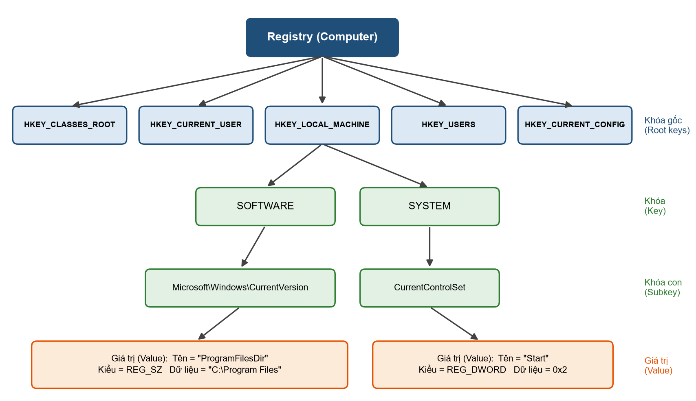
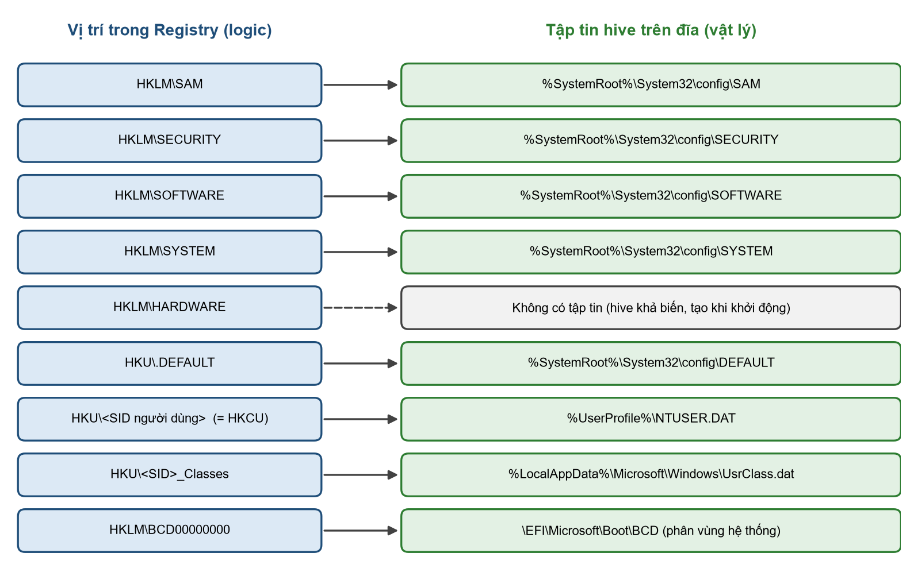
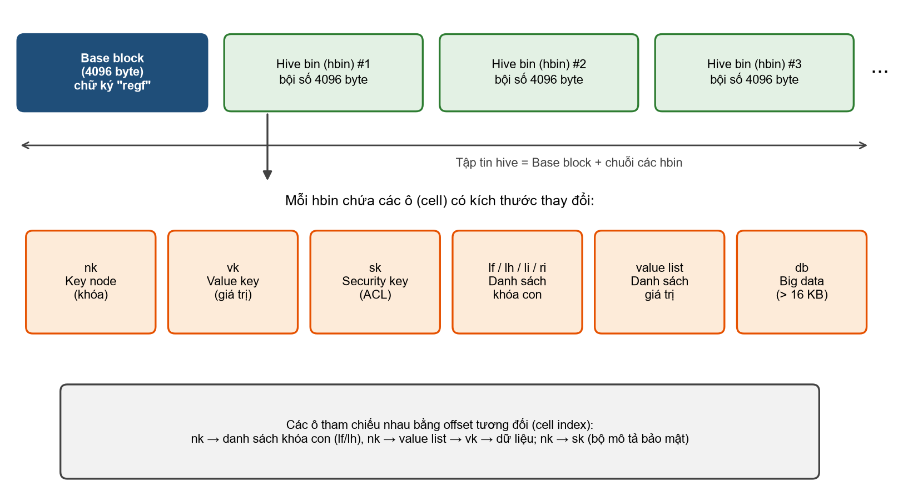
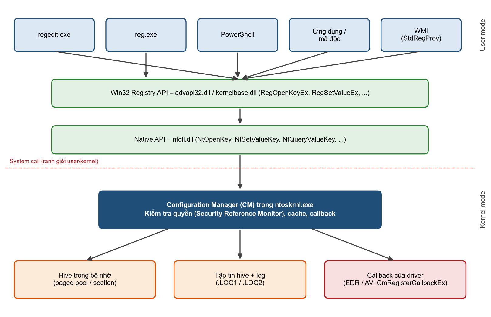
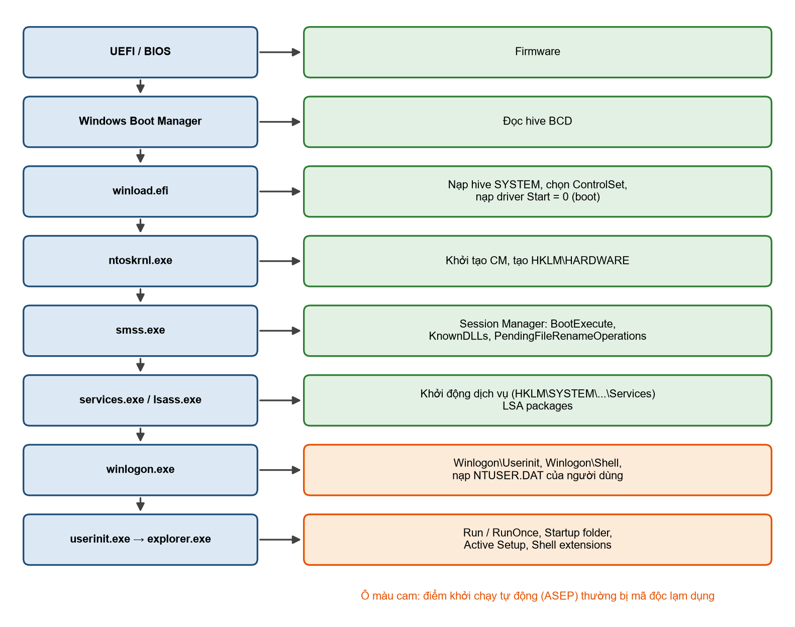
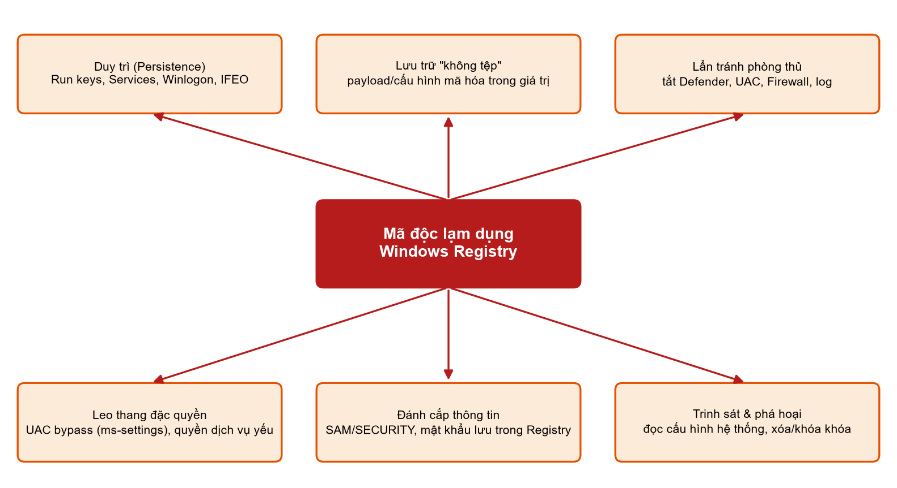
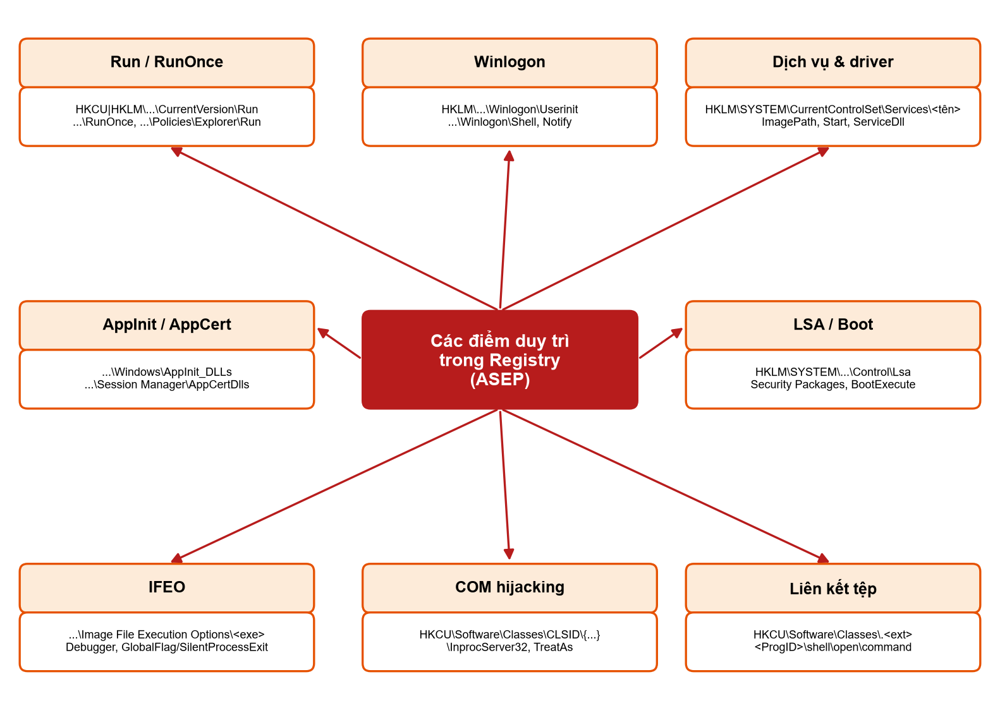

# Kiến thức nền dễ hiểu – Windows Registry và mã độc

Tài liệu ôn tập của **Nhóm 03**, học phần *Hệ điều hành Windows và Linux/Unix*. Mục đích: để các thành viên đọc trước khi thuyết trình, hiểu được **bản chất** của từng khái niệm trên slide và trả lời được câu hỏi của giảng viên.

Tài liệu này được viết lại cho **dễ hiểu và tổng quát**. Người đọc chỉ cần kiến thức tin học năm 3, chưa cần chuyên về bảo mật. Mỗi khái niệm được giải thích theo ba câu hỏi: **nó là gì, dùng để làm gì, vì sao quan trọng (nhất là với mã độc)**. Những chỗ cần so sánh cho dễ nhớ sẽ dùng ví dụ đời thường, và luôn ghi rõ "đây chỉ là phép so sánh" để không hiểu sai về mặt kỹ thuật.

> **Hai mức độ chắc chắn – đọc kỹ chỗ này trước.** Tài liệu này là **kiến thức chung** (đúng cho mọi hệ thống Windows). Nó khác với **quan sát trong một báo cáo sandbox cụ thể** (chỉ đúng cho một mẫu, trong một lần chạy). Phần "Ví dụ trong báo cáo sandbox của nhóm" được tách riêng và ghi rõ nguồn. Chúng ta không gán mã *MITRE Software* cho bất kỳ họ mã độc nào, và không kết luận chắc chắn về hành vi của một mẫu nếu báo cáo không quan sát trực tiếp.

---

## Mục lục

- [Kiến thức nền dễ hiểu – Windows Registry và mã độc](#kiến-thức-nền-dễ-hiểu--windows-registry-và-mã-độc)
  - [Mục lục](#mục-lục)
  - [Phần mở đầu: Bức tranh lớn trong 5 phút](#phần-mở-đầu-bức-tranh-lớn-trong-5-phút)
- [PHẦN A. WINDOWS REGISTRY LÀ GÌ VÀ HOẠT ĐỘNG RA SAO](#phần-a-windows-registry-là-gì-và-hoạt-động-ra-sao)
  - [A1. Registry là gì (slide 3)](#a1-registry-là-gì-slide-3)
  - [A2. Registry dùng để làm gì – 7 vai trò (slide 4)](#a2-registry-dùng-để-làm-gì--7-vai-trò-slide-4)
  - [A3. Cấu trúc cây: khóa và giá trị (slide 5)](#a3-cấu-trúc-cây-khóa-và-giá-trị-slide-5)
  - [A4. Năm khóa gốc (slide 6)](#a4-năm-khóa-gốc-slide-6)
  - [A5. Kiểu dữ liệu của giá trị (slide 7)](#a5-kiểu-dữ-liệu-của-giá-trị-slide-7)
  - [A6. Hive – mặt vật lý của Registry (slide 8)](#a6-hive--mặt-vật-lý-của-registry-slide-8)
  - [A7. Configuration Manager – bộ điều phối trong nhân (slide 9)](#a7-configuration-manager--bộ-điều-phối-trong-nhân-slide-9)
  - [A8. Registry trong lúc khởi động (slide 10)](#a8-registry-trong-lúc-khởi-động-slide-10)
  - [A9. Phân quyền: DACL, SACL, ACE (slide 11)](#a9-phân-quyền-dacl-sacl-ace-slide-11)
  - [A10. Các lớp bảo vệ ở mức hệ thống (slide 12)](#a10-các-lớp-bảo-vệ-ở-mức-hệ-thống-slide-12)
  - [A11. Sao lưu và khôi phục (slide 13)](#a11-sao-lưu-và-khôi-phục-slide-13)
  - [A12. Công cụ quản trị Registry (slide 14)](#a12-công-cụ-quản-trị-registry-slide-14)
- [PHẦN B. VÌ SAO MÃ ĐỘC QUAN TÂM REGISTRY](#phần-b-vì-sao-mã-độc-quan-tâm-registry)
  - [B1. Phân loại mã độc theo chức năng (slide 15)](#b1-phân-loại-mã-độc-theo-chức-năng-slide-15)
  - [B2. Sáu mục đích lạm dụng Registry (slide 16)](#b2-sáu-mục-đích-lạm-dụng-registry-slide-16)
  - [Ghi chú về MITRE ATT\&CK và thay đổi năm 2026](#ghi-chú-về-mitre-attck-và-thay-đổi-năm-2026)
- [PHẦN C. SÁU KIỂU LẠM DỤNG REGISTRY (slide 17–22)](#phần-c-sáu-kiểu-lạm-dụng-registry-slide-1722)
  - [C1. Duy trì sự hiện diện – Persistence (slide 17)](#c1-duy-trì-sự-hiện-diện--persistence-slide-17)
  - [C2. Lưu trữ "không tệp" – Fileless Storage (slide 18)](#c2-lưu-trữ-không-tệp--fileless-storage-slide-18)
  - [C3. Lẩn tránh phòng thủ – Defense Evasion (slide 19)](#c3-lẩn-tránh-phòng-thủ--defense-evasion-slide-19)
  - [C4. Leo thang đặc quyền – Privilege Escalation (slide 20)](#c4-leo-thang-đặc-quyền--privilege-escalation-slide-20)
  - [C5. Đánh cắp thông tin – Credential Access (slide 21)](#c5-đánh-cắp-thông-tin--credential-access-slide-21)
  - [C6. Trinh sát và phá hoại – Discovery và Impact (slide 22)](#c6-trinh-sát-và-phá-hoại--discovery-và-impact-slide-22)
  - [Bảng tóm tắt 6 kiểu](#bảng-tóm-tắt-6-kiểu)
- [PHẦN D. PHÁT HIỆN VÀ PHÒNG CHỐNG (NÓI CHUNG)](#phần-d-phát-hiện-và-phòng-chống-nói-chung)
- [PHẦN E. CÂU HỎI CHÉO THƯỜNG GẶP](#phần-e-câu-hỏi-chéo-thường-gặp)
- [PHẦN F. BẢNG THUẬT NGỮ ANH – VIỆT](#phần-f-bảng-thuật-ngữ-anh--việt)
- [PHẦN G. CÁC LỖI TRÊN SLIDE CẦN SỬA](#phần-g-các-lỗi-trên-slide-cần-sửa)

---

## Phần mở đầu: Bức tranh lớn trong 5 phút

Trước khi đi vào từng slide, hãy nắm bốn ý lớn sau. Nếu hiểu bốn ý này, phần còn lại chỉ là chi tiết.

**1. Registry là "sổ cái cấu hình" của Windows.**
Hãy tưởng tượng Windows như một tòa nhà lớn. Nó cần một **cuốn sổ ghi mọi thiết lập**: cửa nào mở lúc mấy giờ, ai được vào phòng nào, bật thiết bị nào khi khởi động. Registry chính là cuốn sổ đó: một **cơ sở dữ liệu phân cấp** lưu cấu hình của hệ điều hành, phần cứng, phần mềm và từng người dùng. Trước khi có Registry, các thiết lập nằm rải rác trong nhiều tệp văn bản nhỏ (`.ini`, `CONFIG.SYS`, `AUTOEXEC.BAT`); Registry gom lại thành một hệ thống có cấu trúc.

**2. Registry được đọc rất sớm và rất thường xuyên.**
Windows đọc Registry ngay từ lúc bật máy, trước cả khi người dùng đăng nhập, và liên tục trong khi chạy. Chính vì nó "luôn được hệ thống tin tưởng và đọc đến", nên nếu kẻ xấu viết được một dòng vào đúng chỗ, Windows sẽ ngoan ngoãn thực hiện. Đây là lý do cốt lõi khiến mã độc mê Registry.

**3. Mã độc quan tâm Registry vì bốn đặc điểm.**
> **Hiểu nhanh:** Registry (a) **luôn sẵn có** trên mọi máy Windows; (b) **tồn tại qua các lần khởi động** (ghi vào là còn mãi); (c) **đọc/ghi được bằng công cụ hợp lệ** có sẵn (nên khó phân biệt với hoạt động bình thường); (d) **chứa được dữ liệu lớn** (nên có thể giấu cả đoạn mã trong đó).

**4. Có sáu "kiểu" mã độc lạm dụng Registry.**
Nhìn một cái là nhớ được cả sáu:

| # | Kiểu (tiếng Việt) | Một câu mô tả |
|---|---|---|
| 1 | **Duy trì** (Persistence) | Ghi một điểm để Windows tự chạy lại mã độc sau khi khởi động. |
| 2 | **Lưu trữ "không tệp"** (Fileless Storage) | Giấu đoạn mã/payload ngay trong một giá trị Registry thay vì để thành tệp. |
| 3 | **Lẩn tránh phòng thủ** (Defense Evasion) | Sửa công tắc cấu hình để làm yếu phần mềm bảo mật. |
| 4 | **Leo thang đặc quyền** (Privilege Escalation) | Lợi dụng cách Windows đọc Registry để chạy mã với quyền cao hơn. |
| 5 | **Đánh cắp thông tin** (Credential Access) | Đọc mật khẩu, bí mật mà hệ thống/phần mềm lưu trong Registry. |
| 6 | **Trinh sát và phá hoại** (Discovery và Impact) | Đọc cấu hình để "dò đường", hoặc xóa/khóa để gây gián đoạn. |

Phần còn lại của tài liệu đi theo đúng mạch tự nhiên: **Registry là gì → hoạt động ra sao → vì sao bị lạm dụng → sáu kiểu → cách phát hiện và phòng chống.**

# PHẦN A. WINDOWS REGISTRY LÀ GÌ VÀ HOẠT ĐỘNG RA SAO

## A1. Registry là gì (slide 3)

> **Nói một câu:** Registry là **cơ sở dữ liệu phân cấp** của Windows, nơi lưu cấu hình của hệ điều hành, phần cứng, phần mềm và người dùng.

**Giải thích cho người mới**

- **Nó là gì:** một kho dữ liệu dạng cây (như cây thư mục). Mỗi "ngăn" trong cây chứa các thiết lập.
- **Dùng để làm gì:** để Windows và các ứng dụng đọc/ghi thiết lập một cách thống nhất — ví dụ "mở tệp `.txt` bằng chương trình nào", "dịch vụ nào tự chạy", "hình nền của người dùng này là gì".
- **Vì sao quan trọng với mã độc:** vì nó được hệ thống đọc rất sớm và rất thường xuyên, nên là chỗ lý tưởng để cài "điểm tự chạy" hoặc giấu dữ liệu.

**Ba điểm kỹ thuật nên biết**

1. Registry **không phải là một tệp văn bản**. Không thể mở bằng Notepad. Dữ liệu nằm trong các tệp nhị phân do hệ thống quản lý (gọi là *hive*, xem mục A6).
2. Chương trình không đọc Registry trực tiếp như đọc tệp; phải gọi **hàm API chuyên biệt** (ví dụ `RegOpenKeyEx`, `RegQueryValueEx`, `RegSetValueEx`). Việc "mọi truy cập đều đi qua API" giúp hệ thống kiểm soát và giám sát được.
3. Toàn bộ do một thành phần trong nhân Windows điều phối, gọi là **Configuration Manager** (xem mục A7).

**Một chút lịch sử (đã xác minh, bỏ nhãn "kiểm tra")**

- **Windows 3.1 (1992):** lần đầu có một "cơ sở dữ liệu đăng ký" trung tâm. Khi đó nó chỉ là **một tệp duy nhất** `reg.dat` (giới hạn khoảng 64 KB), dùng **chủ yếu cho liên kết tệp và đối tượng OLE/COM**. (Nguồn: Google Project Zero – *The Windows Registry Adventure*.)
- **Windows NT 3.1 (1993):** Registry được **thiết kế lại hoàn toàn** — thay tệp `reg.dat` đơn lẻ bằng **nhiều hive riêng**, **thêm phân quyền (ACL) cho từng khóa**, và thêm nhiều khóa gốc (HKLM, HKCU, HKU). Đây là nền tảng của Registry hiện đại.

> **Lưu ý về câu trên slide 3.** Câu "Thay thế hoàn toàn... Bắt đầu xuất hiện từ window nt 3.1 (1993)" dễ gây hiểu sai. Chính xác hơn: Registry **xuất hiện sơ khai từ Windows 3.1 (1992)**, rồi **từ Windows NT 3.1 (1993) mới trở thành cơ sở dữ liệu cấu hình trung tâm** có hive và phân quyền, **dần thay thế** (không phải "thay thế hoàn toàn ngay lập tức") các tệp `.ini`, `CONFIG.SYS`, `AUTOEXEC.BAT`. Thực tế một số ứng dụng vẫn dùng tệp `.ini` đến tận nay.

**Ảnh trên slide: "Sơ đồ mô tả quy trình truy vấn Type Registry"**

- Ảnh vẽ một mô hình 4 bước về "đăng ký kiểu dữ liệu" nói chung (một bên hỏi kiểu, một "Type Registry" trả về định nghĩa kiểu rồi chuyển dữ liệu tới dịch vụ phù hợp).
- **Cảnh báo:** đây **không phải** cách Windows Registry hoạt động. Windows Registry **không có** thành phần nào tên "Type Registry". Ảnh chỉ minh họa ý tưởng "registry" ở mức khái niệm chung.
- **Nếu bị hỏi, trả lời thẳng:** "Ảnh này minh họa khái niệm 'registry' chung, không đúng với Windows Registry. Sơ đồ đúng nên là: *ứng dụng → API (`advapi32.dll`) → Configuration Manager trong nhân → hive trên đĩa*." (Xem mục A7 để mô tả sơ đồ đúng.)

**Câu hỏi hay gặp**

- *Registry khác tệp cấu hình thường ở điểm nào?* Có cấu trúc cây, có phân quyền riêng cho từng khóa, có kiểu dữ liệu, truy cập qua API, và do nhân quản lý.
- *Sao không sửa Registry bằng Notepad được?* Vì dữ liệu nằm trong tệp nhị phân (hive) do hệ thống quản lý, không phải tệp văn bản.
- *Registry có từ khi nào?* Sơ khai từ Windows 3.1 (1992); thành cơ sở dữ liệu trung tâm từ Windows NT 3.1 (1993).

---

## A2. Registry dùng để làm gì – 7 vai trò (slide 4)

> **Nói một câu:** Registry quyết định cách Windows **khởi động, chạy dịch vụ, phân quyền người dùng, liên kết tệp và áp dụng chính sách**.

> **Hiểu nhanh:** Gần như mọi thiết lập quan trọng của Windows đều "chạm" vào Registry. Vì thế, nắm vai trò của nó cũng là nắm những chỗ mà mã độc có thể can thiệp.

**Bảy vai trò (giải thích ngắn)**

1. **Cấu hình khởi động và phần cứng:** thông tin driver, thiết bị, tham số khởi động.
2. **Quản lý dịch vụ:** mỗi dịch vụ có một khóa trong `HKLM\SYSTEM\CurrentControlSet\Services`.
3. **Bảo mật và tài khoản:** cơ sở dữ liệu tài khoản cục bộ (hive `SAM`) và chính sách bảo mật (hive `SECURITY`).
4. **Thiết lập người dùng:** hình nền, lịch sử, giao diện; lưu trong `NTUSER.DAT`, hiển thị qua `HKEY_CURRENT_USER`.
5. **Liên kết tệp và COM:** Windows tra Registry để biết mở `.txt` bằng chương trình nào, và CLSID nào ứng với đối tượng COM nào.
6. **Chính sách nhóm (Group Policy):** các chính sách ghi vào khóa `Policies`.
7. **Hiệu năng và chẩn đoán:** dữ liệu hiệu năng truy cập qua `HKEY_PERFORMANCE_DATA`.

> **Muốn biết thêm.** Vai trò nào liên quan nhất tới mã độc? Chủ yếu là **khởi động, dịch vụ và thiết lập người dùng** (nơi đặt điểm tự chạy), cùng với **chính sách** (nơi mã độc tắt bảo mật).

**Ảnh trên slide: "Vai trò của Registry"**

- Một biểu tượng Registry ở giữa, bảy ô màu xung quanh đúng theo 7 vai trò trên, kèm khóa/tệp tiêu biểu (ví dụ ô dịch vụ ghi `HKLM\SYSTEM\CurrentControlSet\Services`, ô người dùng ghi `NTUSER.DAT`). **Khớp tiêu đề slide.**

**Câu hỏi hay gặp**

- *Nếu phải chọn một vai trò để nói kỹ, chọn gì?* Quản lý dịch vụ và điểm tự khởi động, vì đó là nơi mã độc hay nhắm tới nhất.

---

## A3. Cấu trúc cây: khóa và giá trị (slide 5)

> **Nói một câu:** Registry tổ chức thành **cây** gồm khóa gốc, khóa, khóa con và giá trị.

> **Hiểu nhanh:** **Khóa (key) giống thư mục; giá trị (value) giống tệp nằm trong thư mục đó.** Đây là phép so sánh để dễ nhớ — về kỹ thuật, khóa và giá trị do Configuration Manager quản lý chứ không phải do hệ thống tệp.

*Hình: Cấu trúc logic của Registry: khóa gốc, khóa, khóa con và giá trị.*

**Giải thích cho người mới**

- **Khóa (key):** một "nút chứa" trong cây, có thể chứa khóa con và giá trị.
- **Giá trị (value):** nơi chứa dữ liệu thật, gồm **ba phần: tên, kiểu, dữ liệu**.
- Mỗi khóa có một giá trị mặc định tên `(Default)`.
- "Phân cấp" nghĩa là khóa lồng trong khóa, nhiều tầng — giống thư mục lồng thư mục.

**Giới hạn (đã xác minh, bỏ nhãn "kiểm tra")**

Theo tài liệu chính thức của Microsoft (*Registry element size limits*):

| Thành phần | Giới hạn |
|---|---|
| Tên khóa | **255 ký tự** (tính cả đường dẫn đầy đủ, luôn bắt đầu từ một khóa gốc như `HKEY_LOCAL_MACHINE`). |
| Tên giá trị | **16.383 ký tự.** |
| Dữ liệu một giá trị | Bị giới hạn bởi bộ nhớ sẵn có (định dạng mới); 1 MB (định dạng cũ). |
| Độ sâu cây | **512 cấp.** Một lời gọi API tạo khóa chỉ tạo được tối đa **32 cấp** mỗi lần. |

Microsoft khuyến nghị: dữ liệu dài hơn 2.048 byte **nên lưu thành tệp** và chỉ để đường dẫn trong Registry, cho hiệu quả. (Đặc điểm "giá trị chứa được rất nhiều dữ liệu" này về sau bị mã độc lợi dụng để giấu payload — xem C2.)

**Ảnh trên slide: "Cấu trúc Registry dạng cây"**

- Gốc là "Registry (Computer)", xuống 5 khóa gốc; từ `HKEY_LOCAL_MACHINE` xuống `SOFTWARE`/`SYSTEM`, rồi tới khóa con và cuối cùng là giá trị (ví dụ `ProgramFilesDir` kiểu `REG_SZ`, `Start` kiểu `REG_DWORD`). Cột nhãn bên phải ghi 4 tầng: khóa gốc, khóa, khóa con, giá trị. **Khớp chữ, nhưng ảnh hơi mờ.**

**Câu hỏi hay gặp**

- *Khóa khác giá trị thế nào?* Khóa là nút chứa; giá trị là nơi chứa dữ liệu thật.
- *Tên giá trị dài nhất bao nhiêu?* 16.383 ký tự — rất dài, nên có thể chứa cả một đoạn mã hóa.

---

## A4. Năm khóa gốc (slide 6)

> **Nói một câu:** Có **5 khóa gốc** người dùng thường thấy, nhưng chỉ **HKLM và HKU là nơi lưu thật**, ba khóa còn lại là **nhánh dẫn xuất** (đường dẫn tắt/khung nhìn gộp).

> **Hiểu nhanh:** Hãy coi HKLM là "khu vực chung của cả tòa nhà" và HKU là "khu vực của từng cư dân". Ba khóa còn lại chỉ là **tấm biển chỉ đường** trỏ vào hai khu vực đó.

| Khóa gốc | Viết tắt | Bản chất |
|---|---|---|
| `HKEY_LOCAL_MACHINE` | HKLM | Cấu hình **toàn máy**: phần cứng, phần mềm, dịch vụ, bảo mật. |
| `HKEY_USERS` | HKU | Dữ liệu của **mọi hồ sơ người dùng**, mỗi người một nhánh theo SID. |
| `HKEY_CURRENT_USER` | HKCU | **Đường dẫn tắt** tới nhánh của người đang đăng nhập (`HKU\<SID>`). |
| `HKEY_CLASSES_ROOT` | HKCR | **Khung nhìn gộp** của `HKLM\Software\Classes` và `HKCU\Software\Classes`: liên kết tệp, COM. |
| `HKEY_CURRENT_CONFIG` | HKCC | **Đường dẫn tắt** tới hồ sơ phần cứng hiện tại. |

> **Muốn biết thêm (đã xác minh).**
> - **HKCU** map tới nhánh của người dùng hiện tại trong HKU; thực chất dữ liệu nằm trong tệp `NTUSER.DAT`.
> - **HKCR** là *khung nhìn gộp*; khi cùng một mục tồn tại ở cả hai nơi thì **thiết lập của người dùng (`HKCU\Software\Classes`) được ưu tiên** hơn thiết lập chung của máy. (Nguồn: Microsoft *HKEY_CLASSES_ROOT Key*.)
> - **HKCC** là bí danh (alias) của `HKLM\System\CurrentControlSet\Hardware Profiles\Current`.
> - Ngoài ra còn `HKEY_PERFORMANCE_DATA`: một khóa **ảo** cho dữ liệu hiệu năng, **dữ liệu không thực sự lưu trong Registry** mà được hệ thống thu thập khi truy vấn; **không hiện trong Registry Editor.**

**Vì sao quan trọng với mã độc**

- **HKCU ghi được bằng quyền người dùng thường** (không cần quản trị), nên là nơi ưa thích để cài điểm tự chạy.
- **Ghi vào HKLM thường cần quyền quản trị**, nên ảnh hưởng lớn hơn nhưng khó hơn.

**Ảnh trên slide: "Sơ đồ cấu trúc phân cấp của Windows Registry"**

- "Windows Registry" ở trên cùng, hai nhánh lớn `HKEY_LOCAL_MACHINE` (có `Hardware`, `Software`, `System`) và `HKEY_USER` (có `Default`, các nhánh SID). Hàng dưới là `HKEY_CURRENT_USER`, `HKEY_CURRENT_CONFIG`, `HKEY_CLASSES_ROOT` với mũi tên từ hai nhánh trên chỉ xuống.
- **Ý của hình:** HKLM và HKU là hai nơi lưu thật; ba khóa còn lại suy ra từ chúng. **Khớp ý bảng trên**, nhưng ảnh độ phân giải thấp.

**Câu hỏi hay gặp**

- *HKCU nằm ở đâu thật sự?* Trong tệp `NTUSER.DAT` của người dùng, được nạp vào `HKU\<SID>`.
- *Vì sao mã độc thích HKCU?* Người dùng thường vẫn ghi được, không bị UAC chặn.

> **Lưu ý:** slide có lỗi chính tả `HKEY_CURRENT_USERE` (thừa chữ E). Xem Phần G.

---

## A5. Kiểu dữ liệu của giá trị (slide 7)

> **Nói một câu:** Mỗi giá trị có một **kiểu dữ liệu** để Windows biết cách hiểu chuỗi byte được lưu (là chữ, số, hay dữ liệu nhị phân).

> **Hiểu nhanh:** Cùng một dãy byte có thể là "một con số" hoặc "một đoạn chữ", tùy cách đọc. Kiểu dữ liệu chính là **nhãn dán** nói cho Windows biết phải đọc theo cách nào.

**Các kiểu thường gặp (đã xác minh với winnt.h / tài liệu Microsoft)**

| Kiểu | Mã số | Ý nghĩa ngắn |
|---|---|---|
| `REG_NONE` | 0 | Không có kiểu xác định. |
| `REG_SZ` | 1 | Chuỗi ký tự thông thường (kết thúc bằng ký tự rỗng). |
| `REG_EXPAND_SZ` | 2 | Chuỗi có biến môi trường, ví dụ `%SystemRoot%`, được thay giá trị thật khi đọc. |
| `REG_BINARY` | 3 | Dữ liệu nhị phân thô, bất kỳ dạng gì. |
| `REG_DWORD` | 4 | Số nguyên 32 bit (hay dùng làm cờ bật/tắt). |
| `REG_DWORD_BIG_ENDIAN` | 5 | Số 32 bit dạng big-endian (hiếm dùng trên Windows). |
| `REG_LINK` | 6 | Liên kết tượng trưng tới khóa khác. |
| `REG_MULTI_SZ` | 7 | Nhiều chuỗi nối nhau, kết thúc bằng một chuỗi rỗng. |
| `REG_RESOURCE_LIST` và hai kiểu 9–10 | 8, 9, 10 | Các kiểu "danh sách tài nguyên" cho thiết bị Plug-and-Play. |
| `REG_QWORD` | 11 | Số nguyên 64 bit. |

> **Muốn biết thêm.** `REG_DWORD` thực ra là `REG_DWORD_LITTLE_ENDIAN` (Windows chạy kiến trúc little-endian). `REG_MULTI_SZ` cần **hai ký tự rỗng** ở cuối để báo hết danh sách. Những chi tiết này ít khi bị hỏi, nhưng biết thì yên tâm.

**Vì sao quan trọng với mã độc**

- Đường dẫn tới tệp chạy thường là `REG_SZ`.
- Payload/plugin mã hóa hoặc nén thường để dưới dạng `REG_BINARY`.
- Cờ cấu hình (như `EnableLUA`, `DisableTaskMgr`) thường là `REG_DWORD` (0 hoặc 1 là đủ làm công tắc).

**Ảnh trên slide: "Các kiểu dữ liệu giá trị trong Registry"**

- Bảng 12 dòng, cột "ID loại" từ 0 đến 11, đúng theo danh sách trên (0 `REG_NONE` ... 11 `REG_QWORD`). **Khớp chữ và đúng với tài liệu Microsoft**, nhưng chữ nhỏ, khó đọc khi chiếu.

**Câu hỏi hay gặp**

- *Vì sao `REG_DWORD` hay dùng để bật/tắt?* Vì 0/1 là đủ làm công tắc.
- *`REG_SZ` khác `REG_EXPAND_SZ` thế nào?* Cái sau chứa biến môi trường được Windows thay bằng giá trị thật khi đọc.

---

## A6. Hive – mặt vật lý của Registry (slide 8)

> **Nói một câu:** Về mặt vật lý, Registry **không phải một tệp** mà là **nhiều hive**, mỗi hive là một tệp nhị phân trên đĩa.

> **Hiểu nhanh:** Nếu Registry là "cuốn sổ cấu hình", thì mỗi **hive** là một **cuốn tập rời** của cuốn sổ đó, cất trên đĩa. Khi Windows chạy, nó nạp các cuốn tập này vào bộ nhớ rồi ghép lại thành cây mà ta thấy trong `regedit`.

*Hình: Vị trí logic của các nhánh Registry và tệp hive tương ứng trên đĩa.*

*Hình: Cấu trúc tệp hive (định dạng regf): base block, hive bin và các ô dữ liệu.*

**Giải thích cho người mới**

- **Hive** = một nhóm khóa/khóa con/giá trị được lưu cùng nhau, kèm các tệp hỗ trợ, nạp vào bộ nhớ khi khởi động hoặc khi người dùng đăng nhập. (Định nghĩa theo Microsoft.)
- Tệp hive có **chữ ký `regf`** ở đầu; **base block** là 4.096 byte đầu (chứa chữ ký, phiên bản, thời gian, checksum); phần thân chia thành các **hive bin** (kích thước là bội số của 4.096 byte) chứa các **ô (cell)** dữ liệu.

**Các hive tiêu biểu và tệp tương ứng (đã xác minh)**

| Vị trí logic | Tệp vật lý |
|---|---|
| `HKLM\SAM` | `%SystemRoot%\System32\config\SAM` |
| `HKLM\SECURITY` | `...\config\SECURITY` |
| `HKLM\SOFTWARE` | `...\config\SOFTWARE` |
| `HKLM\SYSTEM` | `...\config\SYSTEM` |
| `HKU\<SID>` (hiện qua HKCU) | `%UserProfile%\NTUSER.DAT` |
| `HKU\<SID>_Classes` | `%LocalAppData%\Microsoft\Windows\UsrClass.dat` |
| `HKLM\HARDWARE` | Không có tệp — hive **khả biến**, tạo lại mỗi lần khởi động |

> **Giải thích hai từ dễ nhầm.**
> - **Khả biến (volatile):** hive chỉ tồn tại **trong bộ nhớ**, mất khi tắt máy (ví dụ `HKLM\HARDWARE`).
> - "**Bất biến**" trên slide nên hiểu là "**không khả biến**", tức được **lưu trên đĩa** — **không** có nghĩa là "không sửa được".

**Nhật ký giao dịch – chi tiết dễ bị hỏi, đã xác minh và có đính chính**

Mỗi hive có tệp **nhật ký giao dịch** để khôi phục khi mất điện/lỗi. Cần phân biệt hai mốc (theo đặc tả định dạng regf của M. Suhanov):

- **Cơ chế hai nhật ký (`.LOG1` và `.LOG2`) xuất hiện từ Windows Vista** (dual-logging). Hệ thống ghi luân phiên hai tệp.
- **Định dạng nhật ký mới, ghi tăng dần (incremental logging)** mới là thứ **xuất hiện từ Windows 8.1 / Server 2012 R2** (các mục nhật ký có chữ ký `HvLE`).

> **Đính chính so với bản nháp cũ.** Bản ghi chú trước nói "từ Windows 8.1 mỗi hive có hai tệp `.LOG1`/`.LOG2`". Chính xác hơn: **hai tệp `.LOG1`/`.LOG2` có từ Windows Vista**; Windows 8.1 đổi **định dạng/cơ chế** ghi nhật ký (ghi tăng dần). Khi thuyết trình, nếu không chắc, chỉ cần nói "Windows hiện đại dùng hai tệp nhật ký luân phiên để bảo toàn dữ liệu khi mất điện".

- **Hệ quả cho điều tra số:** dữ liệu mới nhất có thể **còn nằm trong `.LOG1`/`.LOG2`** mà chưa ghi vào hive chính (cơ chế mới có thể trì hoãn ghi tới khoảng một giờ). Vì vậy khi thu thập chứng cứ phải **sao chép cả hive lẫn các tệp nhật ký**.
- **`Amcache.hve`** (trong `C:\Windows\appcompat\Programs`) là một hive ghi lại thông tin các chương trình đã chạy — rất hữu ích cho điều tra.

**Ảnh trên slide**

- **Bên trái, "Cấu trúc hive registry":** ảnh chụp Registry Editor (giao diện cũ) với ba chú thích **Hive / Keys / Subkeys**, minh họa hive là tập hợp khóa, khóa con, giá trị. Ảnh có hình mờ của trang nguồn.
- **Bên phải, "Một số hive tiêu chuẩn":** bảng vị trí logic ↔ tệp (SAM, NTUSER.DAT, UsrClass.dat, HARDWARE...). Dòng `NTUSER.DAT` ghi "Chứa khóa Run của nạn nhân". **Khớp bảng ở trên.**

**Câu hỏi hay gặp**

- *Vì sao `NTUSER.DAT` quan trọng với mã độc?* Vì nó chứa khóa `Run` của người dùng — nơi mã độc hay đặt điểm tự chạy.
- *Hive khả biến là gì?* Hive chỉ ở bộ nhớ, như `HKLM\HARDWARE`.

> **Lưu ý:** slide hơi đông chữ; ảnh regedit cũ nên thay bằng ảnh tự chụp. Xem Phần G.

---

## A7. Configuration Manager – bộ điều phối trong nhân (slide 9)

> **Nói một câu:** **Configuration Manager** là thành phần của nhân điều phối **mọi** truy cập Registry: nạp hive, kiểm tra quyền, lưu đệm, ghi xuống đĩa và thông báo thay đổi.

> **Hiểu nhanh:** Mọi lời gọi Registry — dù từ regedit, PowerShell hay mã độc — đều phải đi qua **một cửa duy nhất** trong nhân. Chính vì có một cửa duy nhất, phần mềm bảo vệ (EDR) chỉ cần "đứng gác ở cửa đó" là giám sát được tất cả.

*Hình: Đường đi của một lời gọi Registry từ ứng dụng tới Configuration Manager trong nhân.*

**Giải thích cho người mới**

Configuration Manager nằm trong `ntoskrnl.exe` (lõi của Windows) và làm các việc:

- **Nạp/tháo hive** vào bộ nhớ.
- **Bộ đệm khối khóa (KCB)** để tra cứu nhanh.
- **Kiểm tra quyền** qua Security Reference Monitor.
- **Ghi trễ (lazy flush):** gom thay đổi lại rồi mới ghi xuống nhật ký và hive (nên dữ liệu mới nhất có thể còn ở bộ nhớ/nhật ký).
- **Thông báo thay đổi:** cho ứng dụng (`RegNotifyChangeKeyValue`) và cho driver qua **callback** (`CmRegisterCallbackEx`). Driver bảo mật (EDR, diệt virus) đăng ký callback để được báo mọi thao tác và **có thể chặn**.

**Ảnh trên slide: "Kiến trúc truy cập Registry trong Windows"**

Đây là sơ đồ **đúng chủ đề** (nên đối chiếu với ảnh sai ở slide 3). Đọc từ trên xuống:

1. **Chế độ người dùng:** các chương trình (Registry Editor, `reg.exe`, PowerShell, ứng dụng, WMI)
2. → **Win32 Registry API** (`advapi32.dll`/`kernelbase.dll`: `RegOpenKeyEx`, `RegQueryValueEx`...)
3. → **Native API** (`ntdll.dll`: `NtOpenKey`, `NtQueryValueKey`...)
4. → qua ranh giới người dùng/nhân vào **Configuration Manager**.
5. Từ đó ra ba nơi: **hive trong bộ nhớ**, **tệp nhật ký** (`.LOG1`/`.LOG2`), và **callback cho driver** (EDR/diệt virus).

**Ý của hình:** mọi lời gọi đi qua nhiều lớp rồi tụ về một điểm trong nhân — đó là chỗ lý tưởng để giám sát. **Khớp chữ** (chữ hơi nhỏ).

**Câu hỏi hay gặp**

- *Vì sao quan trọng với phòng thủ?* Vì EDR dựa vào **callback** này để giám sát và chặn thao tác Registry đáng ngờ theo thời gian thực.
- *"Ghi trễ" nghĩa là gì?* Thay đổi chưa chắc ghi xuống đĩa ngay; dữ liệu mới nhất có thể còn ở bộ nhớ hoặc nhật ký.

---

## A8. Registry trong lúc khởi động (slide 10)

> **Nói một câu:** Registry tham gia **hầu hết** các giai đoạn khởi động, từ đọc cấu hình boot đến chạy các chương trình tự khởi động.

> **Hiểu nhanh:** Windows khởi động giống như mở cửa hàng buổi sáng: đọc danh sách việc cần làm (trong Registry) rồi lần lượt bật thiết bị, chạy dịch vụ, cho nhân viên vào. Mã độc chỉ cần **chèn tên mình vào đúng danh sách** là được chạy cùng.

*Hình: Registry trong quá trình khởi động Windows; ô màu cam là các điểm tự khởi động.*

**Theo thứ tự (đơn giản hóa)**

1. **Boot Manager:** đọc dữ liệu cấu hình khởi động (BCD — bản thân cũng là một hive).
2. **Winload:** nạp hive `SYSTEM`, xác định bộ điều khiển (ControlSet) và driver khởi động.
3. **Kernel:** khởi tạo Configuration Manager, nạp các hive.
4. **`smss.exe`:** xử lý `BootExecute`, thiết lập phiên hệ thống.
5. **`services.exe`:** đọc `HKLM\SYSTEM\CurrentControlSet\Services` để chạy driver và dịch vụ.
6. **`winlogon.exe`:** xử lý đăng nhập, nạp `NTUSER.DAT`, đọc `Userinit` và `Shell`.
7. **`explorer.exe`:** hiện Desktop và chạy các chương trình tự khởi động (khóa `Run`, thư mục Startup).

> **Muốn biết thêm (đã xác minh): giá trị `Start` của dịch vụ.** Mỗi dịch vụ có giá trị `Start` quyết định khi nào chạy: **0 = Boot, 1 = System, 2 = Automatic, 3 = Manual (theo yêu cầu), 4 = Disabled.** (Nguồn: Microsoft, `StartType`.)

**Ảnh trên slide: "Vai trò của Registry trong quá trình khởi động và đăng nhập"**

- Sơ đồ dọc nối tiếp: UEFI/BIOS → Windows Boot Manager → `winload.efi` → `ntoskrnl.exe` → `smss.exe` → `csrss.exe` → `services.exe`/`lsass.exe` → `winlogon.exe` → `userinit.exe`/`explorer.exe`.
- Hai ô cuối (màu cam) nhấn vào phần Registry của đăng nhập: `Winlogon` (`Shell`, `Userinit`), `Run`/`RunOnce`, thư mục Startup, Active Setup.
- **Ý của hình:** các ô cam chính là những **điểm tự khởi động (ASEP)** mà mã độc nhắm tới. **Khớp chữ.**

**Câu hỏi hay gặp**

- *Mã độc chen vào đâu?* Ở các điểm đọc cấu hình: `Run`/`RunOnce`, `Services`, `Winlogon` (`Shell`, `Userinit`), `BootExecute`.

---

## A9. Phân quyền: DACL, SACL, ACE (slide 11)

> **Nói một câu:** Mỗi khóa Registry có một **danh sách quyền (DACL)** quyết định ai được làm gì, và một **danh sách kiểm toán (SACL)** quyết định thao tác nào được ghi nhật ký.

> **Hiểu nhanh:** Hãy coi mỗi khóa như một căn phòng. **DACL** là danh sách "ai được vào, ai bị cấm". **SACL** là "camera" ghi lại ai ra vào. **Token** của tiến trình giống **thẻ căn cước** ghi người đó là ai và thuộc nhóm nào. (Đây là phép so sánh; thực tế quyền được định nghĩa chi tiết theo từng thao tác.)

**Các khái niệm (giải thích ngắn)**

- **DACL (Discretionary ACL):** danh sách quyền, gồm nhiều **ACE**.
- **ACE (mục kiểm soát):** một dòng gồm *loại* (cho phép / từ chối), *người hoặc nhóm*, và *các quyền*.
- **SACL (System ACL):** quyết định thao tác nào sinh **nhật ký kiểm toán**.
- **Token truy cập:** "thẻ căn cước" của tiến trình — ghi người dùng và các nhóm họ thuộc về.
- NTFS và Registry **dùng chung** mô hình này.
- Quyền thường gặp trên khóa: `KEY_READ`, `KEY_WRITE`, `KEY_SET_VALUE`, `KEY_CREATE_SUB_KEY`, `KEY_ALL_ACCESS`.

**Quy tắc duyệt ACE (đã xác minh với Microsoft *How AccessCheck Works*)**

Hệ thống duyệt các ACE **lần lượt từ trên xuống** và dừng ngay khi:

- gặp một **ACE từ chối** khớp với token (→ từ chối ngay), **hoặc**
- các **ACE cho phép** đã cấp đủ mọi quyền yêu cầu (→ cho phép), **hoặc**
- duyệt hết mà vẫn còn quyền chưa được cấp (→ **ngầm từ chối**).

> **Bài học quan trọng:** vì hệ thống **dừng ngay khi có kết luận**, nên **thứ tự ACE rất quan trọng**, và theo trật tự chuẩn (canonical) các **ACE từ chối được đặt trước** ACE cho phép — nói nôm na "**từ chối thắng cho phép**".

**Kiểm toán cần hai bước và các sự kiện (đã xác minh)**

Muốn ghi nhật ký truy cập một khóa, cần: (1) đặt **SACL** trên khóa đó, (2) bật **chính sách kiểm toán truy cập đối tượng**. Khi đó nhật ký Security ghi (theo tài liệu Microsoft *Audit Registry*):

| Sự kiện | Ý nghĩa |
|---|---|
| **4656** | Một **handle tới đối tượng được yêu cầu** (yêu cầu mở). |
| **4657** | Một **giá trị Registry bị sửa**. |
| **4660** | Một **đối tượng bị xóa**. |
| **4663** | Một **lần truy cập đối tượng** (đọc/ghi...). |

(Ngoài ra còn 4658 đóng handle, 4670 đổi quyền, 5039 khóa bị ảo hóa — ít dùng hơn.)

**Ảnh trên slide: "Quản lý quyền truy cập"**

- Một **đối tượng** có DACL gồm 3 ACE: ACE 1 **từ chối** "Andrew" đọc/ghi/thực thi; ACE 2 **cho phép** "Nhóm A" ghi; ACE 3 **cho phép** "Mọi người" đọc/thực thi.
- **Luồng A** mang token của Andrew (thuộc Nhóm A, B, C); **Luồng B** mang token của Jane (thuộc Nhóm A).
- Hệ thống đọc ACE 1 trước: **Luồng A bị từ chối ngay** (không xét tiếp ACE 2, 3) **dù** Andrew cũng thuộc Nhóm A. **Luồng B** không bị ACE 1 chặn nên đi tiếp tới ACE 2 (được ghi) và ACE 3 (được đọc/thực thi). (Kết quả này đúng với tài liệu Microsoft.)
- Ảnh vẽ cho đối tượng bất kỳ; với Registry, "đối tượng" là một khóa. Ảnh **chỉ minh họa DACL**, không vẽ SACL.

**Câu hỏi hay gặp**

- *Vì sao người dùng thường ghi được HKCU nhưng không ghi được `HKLM\SOFTWARE`?* Vì DACL của HKLM chỉ cho quản trị viên ghi.
- *SACL khác DACL thế nào?* DACL kiểm soát **quyền**; SACL kiểm soát **việc ghi nhật ký**.

> **Lưu ý:** ảnh có vài lỗi chữ ("executi", "Ghóm A", trộn "write"/"Group B"). Xem Phần G.

---

## A10. Các lớp bảo vệ ở mức hệ thống (slide 12)

> **Nói một câu:** Ngoài ACL và kiểm toán, Windows còn có **nhiều lớp bảo vệ** Registry.

> **Hiểu nhanh:** Phòng thủ tốt là **nhiều lớp** (defense in depth): nếu một lớp bị qua mặt, còn lớp khác chặn. Không có "một nút bấm" bảo vệ tất cả.

**Năm lớp (giải thích ngắn)**

1. **Group Policy:** chặn người dùng dùng công cụ sửa Registry (giá trị `DisableRegistryTools`) và áp chính sách cấu hình.
2. **Dịch vụ Remote Registry:** cho phép truy cập Registry qua mạng — **nên tắt khi không cần** (giảm bề mặt tấn công).
3. **Tamper Protection (Microsoft Defender):** chặn việc tắt/sửa cài đặt Defender, **kể cả qua Registry**. (Theo Microsoft: khi bật, "các nỗ lực sửa thiết lập của Microsoft Defender Antivirus qua registry đều bị chặn".)
4. **Callback Registry (EDR/diệt virus):** driver bảo mật nhận thông báo và có thể chặn thao tác đáng ngờ theo thời gian thực (xem A7).
5. **Sao lưu và điểm khôi phục:** giúp quay lại trạng thái tốt sau sự cố/tấn công.

**Ảnh trên slide: "Bảo mật registry"**

- Năm ô quanh một biểu tượng Registry ở giữa, đúng theo 5 lớp trên (Group Policy; Remote Registry; Tamper Protection; Callback Registry; Sao lưu/khôi phục gồm System Restore, Volume Shadow Copy). **Khớp chữ.** Lưu ý: chữ trên slide chỉ có câu giới thiệu, nội dung chính nằm trong ảnh, nên người nói cần đọc được ảnh.

**Câu hỏi hay gặp**

- *Mã độc tắt Defender bằng Registry có được không?* Nếu **Tamper Protection** đang bật thì bị chặn. Đó là lý do lớp này quan trọng.

---

## A11. Sao lưu và khôi phục (slide 13)

> **Nói một câu:** Trước khi sửa Registry hoặc xử lý mã độc, **phải có bản sao lưu** để quay lại trạng thái tốt.

> **Hiểu nhanh:** Sao lưu Registry giống **chụp ảnh căn phòng trước khi dọn**: nếu dọn nhầm, còn ảnh để so sánh và khôi phục.

**Bốn cách (giải thích ngắn)**

1. **System Restore (điểm khôi phục hệ thống):** lưu bản sao các hive chính (SAM, SECURITY, SOFTWARE, SYSTEM).
2. **`reg export`:** xuất một nhánh ra tệp `.reg` (dạng văn bản). Nhập lại bằng `reg import`.
3. **`reg save`:** lưu một hive **nhị phân** ra tệp; khôi phục bằng `reg restore` hoặc nạp bằng `reg load`.
4. **Công cụ sao lưu hệ thống** (ảnh hệ thống / Windows Server Backup): sao lưu cả trạng thái hệ thống.

> **Muốn biết thêm (đã xác minh).** Từ **Windows 10 phiên bản 1803**, Windows **không còn tự sao lưu** Registry vào thư mục `RegBack` theo mặc định (các tệp ở đó còn nhưng 0 KB). Microsoft khuyến nghị **dùng điểm khôi phục hệ thống**; nếu muốn bật lại cơ chế cũ thì đặt giá trị `EnablePeriodicBackup`. Đây là lý do "sao lưu thủ công" càng quan trọng.

**Ảnh trên slide: "Sao lưu và khôi phục"**

- Bốn ô đúng theo bốn cách trên (System Restore với biểu tượng 4 hive; `reg export`; `reg save`; công cụ sao lưu hệ thống). **Khớp chữ.**

**Câu hỏi hay gặp**

- *`reg export` khác `reg save` thế nào?* Export ra **tệp văn bản** dễ đọc nhưng **không giữ nguyên quyền ACL**; Save lưu **hive nhị phân**, giữ nguyên hơn nhưng cần quyền cao.
- *Khi nhiễm mã độc, sao lưu để làm gì?* Để có bản gốc đối chiếu và để khôi phục sau khi dọn.

> **Lưu ý:** caption có lỗi "Sao **luu**" (thiếu dấu). Xem Phần G.

---

## A12. Công cụ quản trị Registry (slide 14)

> **Nói một câu:** Có nhiều công cụ xem/sửa Registry, từ giao diện đồ họa đến dòng lệnh và công cụ điều tra.

> **Hiểu nhanh:** Người quản trị và người điều tra dùng chung bộ công cụ này. Điểm mấu chốt cần nhớ: **công cụ điều tra chuyên dụng thấy được những thứ mà `regedit` không thấy** (ví dụ khóa bị giấu).

| Công cụ | Dùng để |
|---|---|
| **Registry Editor** (`regedit`) | Xem, sửa, xuất, nhập bằng giao diện. |
| **`reg.exe`** | Dòng lệnh: `query`, `add`, `delete`, `export`, `import`, `save`, `load`, `compare`. |
| **PowerShell** | Truy cập Registry như ổ đĩa (`HKLM:`, `HKCU:`) bằng `Get-ItemProperty`, `Set-ItemProperty`... |
| **Tệp `.reg`** | Tệp văn bản chứa thay đổi, bấm đúp để áp vào Registry. |
| **Group Policy Editor** | Quản lý chính sách (ghi vào khóa `Policies`). |
| **WMI** | Truy vấn/ghi Registry qua lớp `StdRegProv`. |
| **Event Viewer** | Xem nhật ký kiểm toán Registry. |
| **Sysinternals: Process Monitor, Autoruns** | Theo dõi thao tác Registry theo thời gian thực; liệt kê mọi điểm tự khởi động. |
| **Bên thứ ba** | Regshot (so sánh trước/sau), Registry Explorer, RegRipper (điều tra hive ngoại tuyến). |

**Ảnh trên slide: "Các công cụ quản trị Registry"**

- Lưới 8 ô (regedit, Group Policy Editor, cmd, PowerShell, `reg.exe`, WMI, công cụ bên thứ ba, Event Viewer). **Khớp chữ.** Lưu ý: danh sách chữ trên slide chưa nhắc `cmd`, Group Policy Editor và Event Viewer dù ảnh có — nên thống nhất lại (Phần G).

**Câu hỏi hay gặp**

- *Công cụ nào tốt nhất để phát hiện thay đổi do mã độc?* Process Monitor (thấy tiến trình nào ghi gì), Autoruns (thấy mọi điểm tự chạy), Sysmon (ghi nhật ký lâu dài), Regshot (so sánh hai thời điểm).
- *Vì sao nên dùng công cụ ngoại tuyến để điều tra?* Vì mã độc có thể **giấu khóa khỏi `regedit`** (ví dụ dùng tên có ký tự NUL); phân tích hive ngoại tuyến thì thấy được. (Chi tiết xem C2.)

---

# PHẦN B. VÌ SAO MÃ ĐỘC QUAN TÂM REGISTRY

## B1. Phân loại mã độc theo chức năng (slide 15)

> **Nói một câu:** Mã độc được chia theo **chức năng chính**, và một mẫu thực tế thường **kết hợp nhiều chức năng**.

> **Hiểu nhanh:** "Loại mã độc" giống như "nghề" của nó: có con chuyên trộm, có con chuyên đòi tiền, có con chỉ làm "người giao hàng" cho con khác. Một mẫu thật thường kiêm vài nghề.

| Loại | Đặc điểm ngắn |
|---|---|
| **Virus** | Gắn mã vào tệp khác, lây khi tệp nhiễm được chạy. |
| **Sâu (worm)** | Tự lây qua mạng, không cần người dùng thao tác. |
| **Trojan** | Giả dạng phần mềm hợp lệ để người dùng tự cài. |
| **Backdoor / RAT** | Mở kênh điều khiển từ xa. |
| **Ransomware** | Mã hóa dữ liệu hoặc khóa máy để tống tiền. |
| **Spyware / Stealer** | Đánh cắp mật khẩu, cookie, dữ liệu trình duyệt. |
| **Botnet / Click-fraud** | Biến máy thành nút trong mạng máy tính ma (DDoS, spam, gian lận quảng cáo). |
| **Loader / Dropper** | Chỉ tải hoặc giải nén rồi chạy mã độc giai đoạn sau. |
| **Rootkit** | Che giấu sự hiện diện ở mức nhân hoặc người dùng. |
| **Fileless (không tệp)** | Hạn chế ghi tệp lên đĩa; giữ mã trong bộ nhớ, Registry, WMI; dùng công cụ sẵn có. |

> **Ba điểm hay bị hỏi phân biệt.**
> - **Loader khác dropper:** *dropper* mang sẵn mã độc bên trong rồi "thả" ra; *loader* **tải** mã độc từ ngoài vào.
> - **RAT khác stealer:** *RAT* để kẻ tấn công **điều khiển liên tục**; *stealer* chạy nhanh, lấy dữ liệu rồi gửi đi.
> - **"Fileless" không phải "không có tệp nào":** nghĩa là **phần lõi độc hại không nằm trong một tệp thực thi trên đĩa** (nhưng vẫn cần một điểm kích hoạt).

**Ảnh trên slide: "Các dạng mã độc"**

- Nền tối, 10 ô (hai hàng năm ô) đúng 10 loại ở bảng trên, mỗi ô có biểu tượng và một câu mô tả. **Khớp chữ** (tông màu khác các slide khác).

**Câu hỏi hay gặp**

- *Bảng này có phải phân loại theo Registry không?* **Không.** Đây là phân loại theo **chức năng chung**. Phân loại theo **cách lạm dụng Registry** là slide sau (B2).

---

## B2. Sáu mục đích lạm dụng Registry (slide 16)

> **Nói một câu:** Mã độc dùng Registry cho **sáu mục đích chính**, mỗi mục đích ứng với một nhóm dấu hiệu cần giám sát.

> **Hiểu nhanh:** Sáu mục đích này suy ra thẳng từ bốn đặc điểm của Registry (luôn sẵn có, tồn tại qua khởi động, đọc được bằng công cụ hợp lệ, chứa được nhiều dữ liệu). Đây là **cách nhóm hệ thống hóa cho dễ trình bày**, không phải một khung chuẩn chính thức.

*Hình: Sáu mục đích lạm dụng Registry của mã độc.*

| # | Mục đích (Việt) | Thuật ngữ (Anh) | Dấu hiệu cần giám sát |
|---|---|---|---|
| 1 | Duy trì sự hiện diện | **Persistence** | Giá trị mới ở `Run`, `Services`, `Winlogon`, IFEO. |
| 2 | Lưu trữ "không tệp" | **Fileless Storage** | Giá trị rất dài, chứa Base64 hoặc script. |
| 3 | Lẩn tránh phòng thủ | **Defense Evasion** | Sửa khóa cấu hình Defender, UAC, tường lửa, nhật ký. |
| 4 | Leo thang đặc quyền | **Privilege Escalation** | Ghi vào khóa như `ms-settings`/`mscfile` để bypass UAC; khóa dịch vụ yếu. |
| 5 | Đánh cắp thông tin | **Credential Access** | Tiến trình lạ đọc `SAM`/`SECURITY` hoặc khóa chứa mật khẩu. |
| 6 | Trinh sát và phá hoại | **Discovery** và **Impact** | Đọc cấu hình liên tiếp; xóa hoặc khóa khóa. |

> **Lưu ý về cách gọi.** Trong khung MITRE ATT&CK, mục 1, 3, 4, 5 tương ứng các **chiến thuật (tactic)**; mục 6 gộp **hai chiến thuật** (Discovery và Impact); mục 2 là một **kỹ thuật (technique)** cụ thể. Nên nói thẳng: "Đây là cách nhóm nhóm gọn theo mục đích sử dụng Registry, không phải sao chép khung ATT&CK."

**Ảnh trên slide: "Các mục đích lạm dụng Registry của mã độc"**

- Ô đỏ ở giữa "Mã độc lạm dụng Windows Registry", sáu mũi tên ra sáu ô đúng theo thứ tự trên, và **thứ tự này trùng với thứ tự slide 17–22**. **Khớp chữ.**

---

## Ghi chú về MITRE ATT&CK và thay đổi năm 2026

Phần này giúp trả lời khi giảng viên hỏi về **mã MITRE ATT&CK**. Đọc kỹ vì có một thay đổi lớn mới.

**MITRE ATT&CK là gì:** một khung tri thức phân loại **chiến thuật (tactic — "mục đích")** và **kỹ thuật (technique — "cách làm")** của kẻ tấn công. Kỹ thuật có mã dạng `T1234`, kỹ thuật con dạng `T1234.001`; chiến thuật có mã dạng `TAxxxx`.

**Thay đổi lớn (đã xác minh, tháng 4/2026 — ATT&CK v19; hiện tại là v20, tháng 10/2026):**

- Chiến thuật **"Defense Evasion" đã bị tách** thành **hai** chiến thuật mới:
  - **Stealth (TA0005)** — giữ mã cũ TA0005, nói về "ẩn mình, trà trộn cho giống hoạt động bình thường".
  - **Defense Impairment (TA0112)** — chiến thuật **mới**, nói về "làm hỏng/vô hiệu hóa công cụ bảo mật và nhật ký".
- Kỹ thuật **`T1562` (Impair Defenses) đã bị thu hồi (revoked)** và gộp vào kỹ thuật mới **`T1685` (Disable or Modify Tools)**. Nghĩa là **`T1562.001` cũ nay tương ứng `T1685`.**

> **Dùng thế nào khi thuyết trình.** Slide của nhóm (và bản báo cáo) đang dùng cách gọi cũ "**Lẩn tránh phòng thủ / Defense Evasion**" và mã `T1562.001`. Điều đó **không sai** — chỉ là theo phiên bản ATT&CK trước tháng 4/2026. Nếu giảng viên hỏi "phiên bản mới nhất", trả lời: "Trong ATT&CK v19 (4/2026), Defense Evasion được tách thành **Stealth** và **Defense Impairment**, và `T1562` được gộp vào `T1685`. Nhóm trình bày theo cách gọi quen thuộc để khớp với tài liệu và báo cáo."

**Các kỹ thuật liên quan Registry (đã xác minh trên attack.mitre.org, phiên bản hiện hành — bỏ nhãn "kiểm tra"):**

| Mã | Tên | Chiến thuật (hiện hành) |
|---|---|---|
| `T1547.001` | Registry Run Keys / Startup Folder | Persistence, Privilege Escalation |
| `T1027.011` | Fileless Storage (con của T1027) | Stealth |
| `T1112` | Modify Registry | Defense Impairment, Persistence |
| `T1562.001` → `T1685` | (Impair Defenses:) Disable or Modify Tools | Defense Impairment |
| `T1548.002` | Bypass User Account Control | Privilege Escalation |
| `T1003.002` | OS Credential Dumping: Security Account Manager (SAM) | Credential Access |
| `T1552.002` | Unsecured Credentials: Credentials in Registry | Credential Access |
| `T1012` | Query Registry | Discovery |
| `T1574.011` | Services Registry Permissions Weakness | Stealth, Execution |
| — | *Phá hoại thuộc chiến thuật* **Impact (TA0040)** | Impact |

> **Cảnh báo quan trọng, đã xác minh.** `attack.mitre.org/software/S0265` là **Kazuar**, **không phải Kovter**. Hiện **chưa xác định được mã MITRE Software cho Kovter**, nên **không được bịa** một mã nào. Nguyên tắc chung của nhóm: **không gán mã MITRE Software (Sxxxx) cho họ mã độc** khi chưa kiểm chứng.

---

# PHẦN C. SÁU KIỂU LẠM DỤNG REGISTRY (slide 17–22)

Mỗi kiểu trình bày theo khung: *khái niệm → vì sao dùng Registry → khóa điển hình → phát hiện → phòng chống → ảnh trên slide*. Hai kiểu (C3, C4) kèm **ví dụ thật từ báo cáo sandbox của nhóm**, có ghi rõ nguồn.

> **Nhắc lại nguyên tắc an toàn.** Phần này mô tả ở **mức khái niệm và phòng thủ**. Không có hướng dẫn từng bước để tạo/chạy mã độc, không có lệnh hay khóa độc hại hoàn chỉnh để tấn công.

## C1. Duy trì sự hiện diện – Persistence (slide 17)

> **Nói một câu:** Mã độc ghi một **điểm tự chạy** vào Registry để Windows **tự chạy lại nó** sau khi khởi động hoặc đăng nhập.

> **Hiểu nhanh:** Giống việc **dán tên mình vào danh sách "nhân viên tự vào làm mỗi sáng"**. Windows đọc danh sách đó mỗi lần khởi động, nên mã độc được chạy lại mà không cần người dùng làm gì.

*Hình: Các điểm duy trì (ASEP) phổ biến trong Registry.*

**Vì sao dùng Registry:** Windows **đã đọc sẵn** nhiều khóa tự khởi chạy; mã độc chỉ cần ghi một giá trị chứa đường dẫn tới chính nó.

**Khóa điển hình (mang tính minh họa về vị trí, không phải hướng dẫn tấn công)**

- `HKCU\...\CurrentVersion\Run` — chạy khi người dùng đăng nhập, **không cần quản trị**.
- `HKLM\...\CurrentVersion\Run` — cho mọi người dùng, **cần quản trị**.
- `RunOnce` — chạy một lần rồi tự xóa.
- `HKLM\SYSTEM\CurrentControlSet\Services` — dịch vụ (giá trị `ImagePath` trỏ tới tệp chạy).
- `HKLM\...\Windows NT\CurrentVersion\Winlogon` — các giá trị `Shell`, `Userinit`.
- **IFEO** (`Image File Execution Options`, giá trị `Debugger`).
- **TaskCache** (khi tạo tác vụ lập lịch).

**Phát hiện:** Sysmon Event 12/13 trên các khóa này; **Autoruns** (liệt kê mọi điểm tự chạy); **Regshot** (so sánh trước/sau).

**Mã MITRE:** `T1547.001` (Registry Run Keys / Startup Folder); các biến thể liên quan: `T1547.004` (Winlogon `Shell`/`Userinit`), `T1546.012` (IFEO `Debugger`), `T1543.003` (Windows Service), `T1053.005` (Scheduled Task). (Đã xác minh.)

**Phòng chống:** giới hạn quyền ghi; theo dõi các khóa trên; dùng **danh sách trắng ứng dụng** (AppLocker, hoặc **App Control for Business** — tên mới của *Windows Defender Application Control/WDAC*).

**Ảnh trên slide: "Mã độc duy trì"**

- Bốn cột trái→phải: **Kẻ tấn công → Máy chủ C2 → Máy nạn nhân (Windows) → Tác động lên Registry**. Cột cuối minh họa RAT **sửa Registry để duy trì**, với ba khóa `Run` (HKLM), `Run` (HKCU), `Services`. **Khớp rất sát** chữ trên slide.

**Câu hỏi hay gặp**

- *`Run` khác `RunOnce` thế nào?* `RunOnce` chạy một lần rồi tự xóa.
- *Vì sao `Run` ở HKCU hay bị lạm dụng hơn?* Không cần quyền quản trị.
- *Scheduled Task khác `Run` thế nào?* Task có nhiều trigger, chạy ở mức cao hơn, để lại dấu vết ở nhiều nơi (TaskCache, tệp XML, nhật ký).

> **Lưu ý:** caption có lỗi "Mã **đôc** duy trì". Xem Phần G.

---

## C2. Lưu trữ "không tệp" – Fileless Storage (slide 18)

> **Nói một câu:** Mã độc **cất đoạn mã/payload (thường mã hóa) ngay trong một giá trị Registry**; một lệnh nhỏ ở điểm khởi chạy sẽ đọc và chạy nó.

> **Hiểu nhanh:** Thay vì để "con dao" trên bàn cho ai cũng thấy (tệp trên đĩa), mã độc **giấu dao trong ngăn kéo cấu hình** (giá trị Registry), rồi để một mẩu giấy nhắc "mở ngăn kéo lấy dao" ở điểm tự chạy. Vì không có tệp độc rõ ràng, quét theo tệp khó bắt hơn.

**Vì sao dùng Registry:** giá trị chứa được rất nhiều dữ liệu, **ít bị quét như tệp**, luôn sẵn có, và đọc được bằng công cụ hợp lệ.

**Chuỗi điển hình (mức khái niệm):** điểm khởi chạy (ví dụ một giá trị `Run`) → gọi một **công cụ hợp lệ có sẵn** (LOLBin) như `mshta.exe`, `rundll32.exe`, `powershell.exe` → công cụ đó **đọc giá trị Registry → giải mã → chạy trong bộ nhớ**.

**Dấu hiệu nhận biết:** giá trị **rất dài** hoặc chứa **Base64/JavaScript**; tên khóa **ngẫu nhiên**; chuỗi tiến trình cha–con bất thường (ví dụ `mshta` sinh `powershell`).

> **Hai họ "không tệp" kinh điển (kiến thức chung, đã xác minh).**
> - **Kovter:** theo Microsoft (bài 22/7/2016, *Kovter becomes almost fileless*), Kovter **đăng ký một phần mở rộng tệp ngẫu nhiên** và dùng **`mshta`** để chạy JavaScript độc; **"phần lớn mã độc chỉ nằm trong Registry"**. (Kovter cũng là mẫu nhóm phân tích trong báo cáo.)
> - **Poweliks:** giấu mục `Run` bằng **tên có ký tự NUL/không phải ASCII** mà **`regedit` không hiển thị được**. Đây là lý do cần công cụ điều tra chuyên dụng — ví dụ **RegDelNull** của Sysinternals được tạo ra để xóa các khóa có ký tự NUL mà công cụ chuẩn không đụng tới được (`regedit` dùng Win32 API nên không xử lý được ký tự NUL nhúng trong tên).

**Phát hiện:** Sysmon 13 kèm kiểm tra **kích thước giá trị**; soi chuỗi tiến trình bất thường; phân tích hive ngoại tuyến.

**Mã MITRE:** `T1027.011` (Fileless Storage). (Đã xác minh; hiện thuộc chiến thuật Stealth.)

**Phòng chống:** hạn chế `mshta` và các script host qua chính sách; bật ghi nhật ký PowerShell; dùng EDR.

**Ảnh trên slide: "Mã độc không tệp" (có logo Viettel IDC)**

- Sơ đồ lục giác 6 bước về **chuỗi tấn công fileless nói chung**: thư rác chứa liên kết → người dùng nhấp → trang web tải Flash (có lỗ hổng) → Flash mở **PowerShell** → PowerShell tải và chạy mã từ C2 → gửi dữ liệu đi.
- **Cảnh báo:** ảnh **không có bước Registry**. Nó chỉ khớp ý "dùng công cụ hợp lệ, chạy trong bộ nhớ", **không** minh họa "cất mã trong giá trị Registry". Ảnh lại có **logo của nhà cung cấp ngoài**.
- **Nếu bị hỏi:** nói rõ "Ảnh minh họa fileless nói chung; phần Registry của kiểu này là **bước cất và đọc payload trong giá trị**, cần một sơ đồ riêng."

**Câu hỏi hay gặp**

- *"Không tệp" là hoàn toàn không có tệp?* Không. Phần lõi không nằm trong một tệp thực thi trên đĩa, nhưng **vẫn cần một điểm khởi chạy**.
- *Điểm yếu của mã độc không tệp?* Vẫn phải có điểm kích hoạt ghi trong Registry, và **chuỗi tiến trình khi kích hoạt rất bất thường** — đó là chỗ để phát hiện.

> **Lưu ý:** câu trên slide bị hỏng ("phần lõi **nối vào** giá trị Registry"), nên đọc là "phần lõi độc hại **được cất vào** giá trị Registry". Xem Phần G.

---

## C3. Lẩn tránh phòng thủ – Defense Evasion (slide 19)

> **Nói một câu:** Mã độc **sửa cấu hình trong Registry** để làm yếu phần mềm bảo mật và công cụ điều tra.

> **Hiểu nhanh:** Giống kẻ trộm vào nhà rồi **tắt chuông báo động và che camera** trước khi hành động. Nhiều cơ chế an toàn của Windows chỉ là một "công tắc" dạng `REG_DWORD` — đổi 1 thành 0 là tắt.

**Giá trị hay bị sửa (minh họa, không phải hướng dẫn):**

- Chính sách Microsoft Defender (ví dụ tắt chống phần mềm gián điệp).
- `EnableLUA` (công tắc tổng của UAC).
- Tường lửa (`EnableFirewall`).
- `DisableRegistryTools` (khóa Registry Editor).
- `DisableTaskMgr` (khóa Task Manager).
- `DisableSR` (tắt System Restore — xóa khả năng khôi phục).
- `NoRun`.

**Mục đích:** tắt cảnh báo, ngăn người dùng mở công cụ điều tra, xóa khả năng khôi phục.

**Phát hiện:** Event 4657 hoặc Sysmon 13 trên các khóa chính sách; **so với cấu hình chuẩn**.

**Mã MITRE:** `T1112` (Modify Registry) và `T1562.001` (Disable or Modify Tools). *Nhắc lại:* trong ATT&CK v19 (4/2026), `T1562.001` đã được gộp vào `T1685`, và chiến thuật Defense Evasion tách thành Stealth + Defense Impairment (xem [ghi chú MITRE](#ghi-chú-về-mitre-attck-và-thay-đổi-năm-2026)).

**Phòng chống:** bật **Tamper Protection**; đặt ACL chặt trên khóa chính sách; giám sát thay đổi.

> **Ví dụ trong báo cáo sandbox của nhóm — MedusaLocker (ransomware), báo cáo Joe Sandbox ID 1995290.**
> *(Đây là quan sát từ một báo cáo cụ thể, không phải kết luận chung về mọi mẫu MedusaLocker.)*
> Phần *Registry Activities* của báo cáo cho thấy:
> - `HKLM\SOFTWARE\Microsoft\Windows\CurrentVersion\Policies\System\EnableLUA` **đổi từ 1 sang 0** — tức **tắt UAC**. Đây đúng là một ví dụ của "lẩn tránh phòng thủ qua Registry".
> - Tạo giá trị `EnableLinkedConnections` (kiểu dword) cùng nhánh `Policies\System`. *(Kiến thức chung, đã xác minh: giá trị này buộc ổ đĩa mạng đã map hiển thị cho cả phiên quyền cao — cảnh báo công khai AA22-181A của CISA, 30/6/2022, mô tả MedusaLocker dùng nó để lan tới máy/ổ chia sẻ khác qua SMB. Việc này không thuộc "duy trì".)*
> - Tạo khóa `HKCU\SOFTWARE\MDSLK` với giá trị `Self` — đây là **dấu hiệu "đã nhiễm"** (infection marker), **không phải cơ chế duy trì**.
> - **Không thấy** khóa `Run` hay tác vụ lập lịch trong báo cáo này.
> **Điểm cần nhấn mạnh:** các **tác động chính** của ransomware (mã hóa tệp; xóa shadow copy bằng `wmic SHADOWCOPY` / lệnh `vssadmin Delete Shadows` thấy trong bộ nhớ) **không phải thao tác Registry** — chúng thuộc kiểu "phá hoại" (C6). Ngoài ra, bypass UAC kiểu **CMSTP chỉ khớp YARA trong bộ nhớ**, **chưa quan sát thực thi** — nên không nói chắc "mẫu này đã bypass UAC kiểu CMSTP".

**Ảnh trên slide:** **không có ảnh**, nhưng còn **caption cũ** "Sơ đồ hoạt động mã độc stealer" (sai chủ đề). Nếu bị hỏi, nói chưa có sơ đồ và nên có: mã độc ở giữa, mũi tên tới các khóa cấu hình bị sửa (Defender, UAC, Firewall, Task Manager, System Restore).

**Câu hỏi hay gặp**

- *Vì sao mã độc khóa Task Manager?* Để người dùng không tự kết thúc tiến trình đáng ngờ.
- *Tamper Protection giúp gì?* Chặn thay đổi cài đặt Defender, **kể cả qua Registry**.

> **Lưu ý:** slide ghi "Task Manager, **Registry**, System Restore" — nên hiểu là **Registry Editor**. Xem Phần G.

---

## C4. Leo thang đặc quyền – Privilege Escalation (slide 20)

> **Nói một câu:** Mã độc **lợi dụng cách Windows đọc cấu hình từ Registry** để chạy mã với quyền cao hơn, hoặc lợi dụng khóa có quyền ghi quá lỏng.

> **Hiểu nhanh:** Mã độc **đặt sẵn một tờ lệnh vào ngăn kéo của người thường**, rồi chờ một **nhân viên cấp cao** (chương trình hệ thống tự nâng quyền) mở đúng ngăn kéo đó và làm theo — thế là lệnh của kẻ xấu được chạy với quyền cao, không hiện hộp thoại xin quyền.

**Hai cách phổ biến**

1. **UAC bypass qua Registry:** một số chương trình hệ thống **tự nâng quyền** (như `fodhelper.exe`, `eventvwr.exe`) khi chạy sẽ **đọc lệnh từ khóa trong `HKCU\Software\Classes`** (ví dụ `ms-settings\shell\open\command`, `mscfile\shell\open\command`). Người dùng thường **ghi được HKCU**, nên có thể "nhét" lệnh vào cho chương trình quyền cao chạy — mà **không hiện hộp thoại UAC**.
2. **Khóa dịch vụ có quyền yếu:** nếu người dùng thường **sửa được** đường dẫn thực thi (`ImagePath`) của một dịch vụ chạy bằng SYSTEM, mã độc đổi đường dẫn để chạy mã mình.

**Phát hiện:** Sysmon 13 trên các khóa `Classes` liên quan; rà soát DACL của khóa `Services`.

**Mã MITRE:** `T1548.002` (Bypass User Account Control) cho cách 1; `T1574.011` (Services Registry Permissions Weakness) cho cách 2. (Đã xác minh; tài liệu `T1548.002` xác nhận `eventvwr.exe` **tự nâng quyền và chạy tệp/script được chỉ định**.)

**Phòng chống:** đặt UAC ở mức cao; dùng tài khoản thường; ACL chặt cho khóa `Services`; giám sát khóa `Classes` của người dùng.

> **Ví dụ trong báo cáo sandbox của nhóm — NanoCore RAT, báo cáo Joe Sandbox ID 1678954.**
> *(Quan sát từ một báo cáo cụ thể.)*
> Phần *Registry Activities* cho thấy:
> - Tiến trình `plasrv.exe` tạo khóa `HKCU\Software\Classes\mscfile\shell\open\command` với giá trị mặc định trỏ tới `C:\Users\user\AppData\Roaming\DeviceCensus\plasrv.exe`.
> - Sau đó `eventvwr.exe` (cả 32 và 64 bit) được chạy **với đặc quyền nâng cao**. Joe ghi chữ ký **"UAC bypass detected (mscfile / eventvwr.exe)"**; luật Sigma khớp là **"Bypass UAC Using Event Viewer"**. Đây là ví dụ sát với `T1548.002`.
> - Ngoài ra còn thấy duy trì qua `HKLM\Software\Microsoft\Windows\CurrentVersion\Run` giá trị **"DNS Host"** (Sigma "Wow6432Node CurrentVersion Autorun Keys Modification") — phần này thuộc kiểu **duy trì (C1)**.
> **Nghịch lý cần nêu trung thực:** cấu hình trích xuất của NanoCore ghi **`BypassUAC: Disable`**, trong khi bypass UAC **vẫn quan sát được ở một thành phần khác** (`plasrv.exe`). Vì thế **không nói chắc "NanoCore tự bypass UAC"**; chính xác hơn là "trong phiên chạy này, thành phần `plasrv.exe` thực hiện bypass UAC kiểu `mscfile`/`eventvwr`".

**Ảnh trên slide:** **không có ảnh**, còn caption cũ "Sơ đồ hoạt động mã độc stealer" (sai chủ đề). Nên có sơ đồ hai bước: (1) mã độc ghi lệnh vào khóa của người dùng thường; (2) chương trình hệ thống quyền cao đọc khóa đó và chạy lệnh → mã độc chạy với quyền cao.

**Câu hỏi hay gặp**

- *Vì sao ghi vào HKCU lại leo thang được?* Vì chương trình quyền cao đọc cả HKCU của người dùng hiện tại; người thường ghi HKCU được, nên "đưa" lệnh vào cho chương trình quyền cao chạy.
- *Slide chỉ ghi "Remcos,..."?* Với Remcos, báo cáo của nhóm **chỉ thấy chuỗi tắt UAC trong bộ nhớ, chưa thấy thực thi**. Nên nói thẳng: kiểu này chủ yếu là **kiến thức chung**; mẫu minh họa **rõ nhất** là **NanoCore** (ở trên).

---

## C5. Đánh cắp thông tin – Credential Access (slide 21)

> **Nói một câu:** Mã độc **đọc dữ liệu nhạy cảm** do Windows hoặc phần mềm lưu trong Registry.

> **Hiểu nhanh:** Registry không chỉ chứa thiết lập, đôi khi còn chứa **chìa khóa**: mật khẩu băm, bí mật hệ thống, thông tin kết nối của phần mềm. Mã độc đến đó "nhặt chìa".

**Nguồn dữ liệu nhạy cảm (minh họa)**

- Hive **`SAM`** (mật khẩu băm của tài khoản cục bộ) và **`SECURITY`** (bí mật LSA tại `HKLM\SECURITY\Policy\Secrets`). **Cần quyền SYSTEM/quản trị để đọc.**
- **Đăng nhập tự động:** `Winlogon` có thể chứa `DefaultPassword` nếu cấu hình tự đăng nhập.
- **Cấu hình phần mềm:** nhiều phần mềm lưu thông tin kết nối/tài khoản trong Registry của người dùng — ví dụ **PuTTY** (phiên SSH, tại `Software\SimonTatham\PuTTY\Sessions`), **WinSCP**, **Outlook**.

**Phát hiện:** Event 4663 khi tiến trình lạ mở hive nhạy cảm; thao tác `reg save` vào `SAM`; đọc hàng loạt khóa của phần mềm.

**Mã MITRE:** `T1003.002` (OS Credential Dumping: SAM), `T1552.002` (Credentials in Registry); liên quan `T1003.004` (LSA Secrets). (Đã xác minh; tài liệu nêu rõ cần **SYSTEM level access** để đọc SAM.)

**Phòng chống:** không lưu mật khẩu trong Registry; bật **bảo vệ LSA** (`RunAsPPL`, ngăn tiến trình không được bảo vệ đọc bộ nhớ LSASS); EDR chặn truy cập `SAM`.

**Ảnh trên slide: "Sơ đồ hoạt động mã độc stealer"**

- Sơ đồ chuỗi của một stealer (ảnh ghi tên **RedLine Stealer**): phát tán → thả tệp → giải mã cấu hình → thu thập → gửi về C2. Có khung "Mục tiêu cấu hình" (trình duyệt, Steam, FTP, ví tiền mã hóa, Telegram...) và "Thông tin hệ thống".
- **Cảnh báo:** ảnh là họ **RedLine**, trong khi chữ slide nói **Agent Tesla, LokiBot**; và ảnh **không thể hiện thao tác Registry**. Nên ghi chú "minh họa chung".

**Câu hỏi hay gặp**

- *Vì sao cần quyền cao để đọc SAM?* DACL chỉ cho SYSTEM và quản trị viên.
- *Stealer chỉ đọc Registry?* Không. Registry chỉ là **một** nguồn; stealer còn đọc tệp cấu hình, trình duyệt, ví tiền...

> **Lưu ý:** câu trên slide bị dính ("...hệ thống của nạn nhân Registry vừa bị đọc...") và trộn thêm ý "sửa để hạ phòng vệ" (vốn thuộc kiểu C3). Xem Phần G.

---

## C6. Trinh sát và phá hoại – Discovery và Impact (slide 22)

> **Nói một câu:** Mã độc **đọc cấu hình hệ thống** từ Registry để quyết định hành vi (trinh sát), hoặc **xóa/khóa các khóa** để gây gián đoạn (phá hoại).

> **Hiểu nhanh:** Trước khi hành động, kẻ xấu **"nhìn quanh phòng"** (đọc Registry) xem đang ở đâu, có bị theo dõi không. Khi muốn gây hại, nó **đập công tắc** (xóa/khóa khóa).

**Trinh sát (Discovery):**

- Đọc `MachineGuid` (ở `HKLM\SOFTWARE\Microsoft\Cryptography`) để **định danh máy**.
- Đọc phiên bản Windows, thông tin phần cứng.
- Kiểm tra khóa của phần mềm ảo hóa (VirtualBox, VMware) để **né sandbox**.

**Phá hoại (Impact):**

- Xóa khóa khởi động hoặc dịch vụ.
- Vô hiệu hóa công cụ quản trị.
- Xóa khả năng khôi phục (liên quan `DisableSR`).

**Phát hiện:** nhiều lời gọi **đọc Registry liên tiếp** từ cùng một tiến trình; Event 4660 (khóa bị xóa).

**Mã MITRE:** `T1012` (Query Registry) cho trinh sát; `T1497.001` (System Checks — né máy ảo) có kiểm tra khóa ảo hóa; phá hoại thuộc chiến thuật **Impact (TA0040)** (gồm `T1486` mã hóa dữ liệu, `T1490` ngăn khôi phục, `T1489` dừng dịch vụ, `T1485` phá hủy dữ liệu). (Đã xác minh; lưu ý **không có kỹ thuật Impact nào chuyên về Registry** — phá hoại qua Registry thường được xếp theo hành vi cụ thể.)

**Phòng chống:** giám sát khối lượng truy vấn bất thường; sao lưu Registry định kỳ.

> **Nhắc lại từ C3:** phần lớn **"Impact" của ransomware không nằm ở Registry** (mã hóa tệp, xóa shadow copy). Registry chủ yếu là nơi **trinh sát** và đặt vài **công tắc** phụ trợ.

**Ảnh trên slide:** **không có ảnh**; caption còn lại là "Sơ đồ chuỗi hoạt động của mã độc dấu vết gián tiếp" (thuộc nhóm đã bỏ, **sai chủ đề**). Nên có sơ đồ hai nhánh: nhánh "đọc" (ID máy, phiên bản, phần mềm ảo hóa) và nhánh "ghi/xóa" (khóa bị xóa, công cụ bị vô hiệu hóa).

**Câu hỏi hay gặp**

- *Đọc Registry có nguy hiểm không?* Đọc không thay đổi gì, nhưng **báo cho mã độc biết nó đang ở đâu** và có bị theo dõi không.
- *Vì sao mã độc kiểm tra máy ảo?* Để phát hiện sandbox; nếu thấy thì ngừng hoạt động hoặc đổi hành vi, khiến báo cáo sandbox thiếu.

> **Lưu ý:** slide ghi "LokiBot, ObesityLocker". ObesityLocker là ransomware đi kèm một mẫu AsyncRAT, **ít được biết đến**, nên cần có nguồn trước khi nói thêm. Xem Phần G.

---

## Bảng tóm tắt 6 kiểu

| Slide | Kiểu | Registry đóng vai trò gì | Khóa/giá trị điển hình | Chỉ dấu phát hiện chính |
|---|---|---|---|---|
| 17 | Persistence | Điểm tự khởi động | `Run`, `Services`, `Winlogon`, IFEO, TaskCache | Giá trị mới ở các khóa này |
| 18 | Fileless Storage | Nơi cất mã | Giá trị dài, tên ngẫu nhiên | `mshta`/`rundll32` đọc Registry rồi chạy |
| 19 | Defense Evasion | Công tắc cấu hình bảo mật | `EnableLUA`, `DisableTaskMgr`, `DisableRegistryTools`, chính sách Defender | Sửa khóa chính sách |
| 20 | Privilege Escalation | Đường vòng quyền | `Classes\ms-settings`, `Classes\mscfile`, `Services` | Ghi vào `Classes` ngay trước tiến trình nâng quyền |
| 21 | Credential Access | Kho dữ liệu nhạy cảm | `SAM`, `SECURITY`, khóa PuTTY/WinSCP/Outlook | Tiến trình lạ mở hive nhạy cảm |
| 22 | Discovery/Impact | Nguồn thông tin, mục tiêu phá | `MachineGuid`, khóa ảo hóa, khóa khởi động | Đọc hàng loạt hoặc xóa khóa |

---

# PHẦN D. PHÁT HIỆN VÀ PHÒNG CHỐNG (NÓI CHUNG)

> **Hiểu nhanh:** Không có "một viên đạn bạc". Phòng thủ hiệu quả là **nhiều lớp + giám sát theo hành vi + khả năng phục hồi**.

**Công cụ và nhật ký chính (đã xác minh)**

- **Sysmon (Sysinternals)** ghi nhật ký Registry với ba loại sự kiện:
  - **Event 12:** tạo hoặc xóa khóa/giá trị.
  - **Event 13:** đặt giá trị (ghi lại dữ liệu mới, với kiểu DWORD/QWORD).
  - **Event 14:** đổi tên khóa/giá trị.
- **Nhật ký Security** (cần SACL và chính sách kiểm toán): **4656** (yêu cầu mở handle), **4657** (sửa giá trị), **4660** (xóa), **4663** (truy cập).
- **Autoruns:** liệt kê mọi điểm tự khởi động, đối chiếu chữ ký số.
- **Process Monitor:** thấy thao tác Registry theo từng tiến trình.
- **Regshot:** so sánh Registry trước và sau.

**Phát hiện theo hành vi, không theo chuỗi cố định**

- Tên khóa/giá trị của mã độc **thường ngẫu nhiên**, nên **không dùng làm IOC cố định**.
- Chỉ dấu bền hơn là **hành vi**: tiến trình lạ ghi vào điểm tự khởi động; `mshta` đọc Registry rồi chạy mã; PowerShell là tiến trình con của `mshta`.

**Biện pháp phòng chống (gộp theo nhóm)**

- **Giảm quyền:** dùng tài khoản thường, đặt UAC mức cao.
- **Giảm bề mặt tấn công:** tắt Remote Registry; hạn chế `mshta`, script host nếu không dùng.
- **Ngăn chạy trái phép:** danh sách trắng ứng dụng (AppLocker, **App Control for Business**/WDAC).
- **Giám sát:** Sysmon, SIEM, EDR có callback Registry.
- **Phục hồi:** sao lưu Registry, điểm khôi phục, ảnh hệ thống.
- **Bảo vệ cài đặt bảo mật:** bật **Tamper Protection**; bật **bảo vệ LSA** (`RunAsPPL`).

---

# PHẦN E. CÂU HỎI CHÉO THƯỜNG GẶP

1. **Vì sao mã độc thích Registry?** Luôn sẵn có; tồn tại qua các lần khởi động; nhiều điểm tự chạy; dung lượng lớn; đọc được bằng công cụ hợp lệ; ít bị quét như tệp.
2. **Làm sao biết một giá trị Registry là của mã độc?** Nhìn **tiến trình nào ghi nó**, **đường dẫn trỏ tới đâu**, **độ dài/nội dung giá trị**, **chữ ký số** của tệp được trỏ tới, và **thời điểm** xuất hiện.
3. **Xóa giá trị `Run` đã đủ để dọn mã độc chưa?** Chưa. Cần dừng tiến trình đang chạy, xóa tệp, và kiểm tra các điểm tự chạy khác (mã độc thường có nhiều lớp dự phòng).
4. **Mã độc "không tệp" có bị diệt virus phát hiện không?** Khó hơn, vì không có tệp độc để quét. Phải dựa vào **hành vi** và giám sát Registry.
5. **Khác nhau giữa Persistence và Fileless?** *Persistence* là **mục đích** (chạy lại sau khởi động); *Fileless* là **cách giấu mã**. Một mẫu có thể có cả hai (ví dụ Kovter, Poweliks).
6. **HKCU và HKLM khác nhau thế nào với mã độc?** HKCU ghi được bằng quyền thường nhưng chỉ ảnh hưởng một người dùng; HKLM ảnh hưởng toàn máy nhưng cần quyền quản trị.
7. **Sysmon Event 12, 13, 14 khác nhau thế nào?** 12: tạo/xóa; 13: đặt giá trị; 14: đổi tên.
8. **Tại sao không dùng được tên khóa làm IOC?** Mã độc đổi tên ngẫu nhiên mỗi lần, IOC cố định hết hiệu lực nhanh.
9. **"Chưa quan sát" khác "không có" thế nào?** Báo cáo sandbox có thể bị cắt; mẫu có thể nhận ra sandbox và đổi hành vi. **Không thấy không có nghĩa là không làm.**
10. **Vì sao phải nói rõ "quan sát" / "suy ra" / "theo tài liệu công khai"?** Để người nghe biết đâu là bằng chứng thật, đâu là suy luận — tránh nói quá.
11. **Registry xuất hiện từ khi nào?** Sơ khai từ Windows 3.1 (1992, tệp `reg.dat`); thành cơ sở dữ liệu trung tâm có hive và phân quyền từ Windows NT 3.1 (1993).
12. **Mã MITRE của "Lẩn tránh phòng thủ" có đổi gì mới không?** Có. Từ ATT&CK v19 (4/2026), "Defense Evasion" tách thành **Stealth (TA0005)** và **Defense Impairment (TA0112)**; `T1562` gộp vào `T1685`. Slide dùng cách gọi cũ để khớp báo cáo.
13. **Vì sao vài slide có ảnh không khớp (3, 18, 21)?** Nên thừa nhận đó là **ảnh minh họa chung**, và nói rõ phần nào là ý nghĩa cho Registry.

**Nên tránh nói**

- "Mã độc X **luôn** dùng khóa Y" (chỉ nói khi có bằng chứng; nếu không thì "theo tài liệu công khai" / "nhiều khả năng").
- "Không tệp nghĩa là không có tệp nào."
- "Đọc Registry thì không nguy hiểm."
- "Registry thay thế **hoàn toàn** các tệp `.ini`."
- Ghi mã MITRE khi chưa kiểm tra; gán mã MITRE Software (Sxxxx) cho một họ mã độc khi chưa kiểm chứng.

---

# PHẦN F. BẢNG THUẬT NGỮ ANH – VIỆT

| Tiếng Anh | Tiếng Việt | Giải thích ngắn |
|---|---|---|
| Registry | Hệ thống Registry | Cơ sở dữ liệu cấu hình của Windows |
| Hive | Hive | Tệp nhị phân chứa một phần Registry |
| Key / Subkey | Khóa / Khóa con | Nút chứa trong cây Registry |
| Value | Giá trị | Nơi chứa dữ liệu: tên, kiểu, dữ liệu |
| Root key | Khóa gốc | Năm khóa cấp cao nhất (HKLM, HKU, HKCU, HKCR, HKCC) |
| Volatile | Khả biến | Chỉ ở bộ nhớ, mất khi tắt máy |
| Configuration Manager | Bộ quản lý cấu hình | Thành phần nhân quản lý Registry |
| ACL / DACL / SACL / ACE | DS kiểm soát truy cập / quyền / kiểm toán / mục | Cơ chế phân quyền và kiểm toán |
| Access token | Token truy cập | "Thẻ căn cước" của tiến trình |
| ASEP (Auto-Start Extensibility Point) | Điểm tự khởi động | Nơi cấu hình để chương trình tự chạy |
| LOLBin (Living Off the Land Binary) | Công cụ hợp lệ bị lạm dụng | `mshta`, `rundll32`, `powershell`... |
| Fileless malware | Mã độc "không tệp" | Không có tệp thực thi độc hại trên đĩa |
| Loader / Dropper | Trình tải / Trình thả | Tải hoặc thả mã độc giai đoạn sau |
| RAT (Remote Access Trojan) | Trojan điều khiển từ xa | Cho phép điều khiển máy nạn nhân |
| Stealer | Mã độc đánh cắp thông tin | Lấy mật khẩu, dữ liệu |
| Persistence | Duy trì sự hiện diện | Tự chạy lại sau khởi động |
| Defense Evasion | Lẩn tránh phòng thủ | Làm yếu hoặc né bảo mật |
| Stealth / Defense Impairment | Ẩn mình / Làm suy yếu phòng thủ | Hai chiến thuật ATT&CK tách ra từ Defense Evasion (v19, 2026) |
| Privilege Escalation | Leo thang đặc quyền | Chạy với quyền cao hơn |
| Credential Access | Truy cập thông tin xác thực | Đánh cắp mật khẩu |
| Discovery | Trinh sát | Thu thập thông tin hệ thống |
| Impact | Phá hoại | Gây gián đoạn hoặc hủy hoại |
| UAC (User Account Control) | Kiểm soát tài khoản người dùng | Cơ chế xin quyền quản trị; công tắc `EnableLUA` |
| IOC (Indicator of Compromise) | Chỉ dấu bị xâm nhập | Dấu hiệu nhận biết: hash, IP, khóa... |
| Sandbox | Môi trường chạy thử cô lập | Chạy mẫu an toàn để quan sát hành vi |
| EDR | Phát hiện và phản ứng trên máy | Phần mềm giám sát hành vi trên máy |
| Sysmon | Công cụ giám sát hệ thống | Ghi nhật ký chi tiết, gồm Registry |
| MITRE ATT&CK | Khung tri thức chiến thuật/kỹ thuật tấn công | Cách phân loại hành vi tấn công |
| WOW64 / Wow6432Node | Lớp tương thích 32-bit / nhánh chuyển hướng | `HKLM\Software` của app 32-bit trỏ vào `...\Wow6432Node` |

---

# PHẦN G. CÁC LỖI TRÊN SLIDE CẦN SỬA

| Slide | Lỗi | Gợi ý sửa |
|---|---|---|
| 1 | "Nguy cơ **cấc** phần mềm" | Sửa thành "các" |
| 3 | Câu "Thay thế hoàn toàn... Bắt đầu xuất hiện từ window nt 3.1 (1993)" dễ hiểu sai, sai chính tả | "Registry xuất hiện từ Windows 3.1 (1992); từ Windows NT 3.1 (1993) trở thành nơi lưu cấu hình trung tâm, **dần thay thế** các tệp `.ini`, `CONFIG.SYS`, `AUTOEXEC.BAT`." |
| 3 | Ảnh "Type Registry" không phải Windows Registry | Thay bằng sơ đồ: ứng dụng → API → Configuration Manager → hive |
| 6 | `HKEY_CURRENT_USERE` | Sửa thành `HKEY_CURRENT_USER` |
| 8 | Caption "bất biến" dễ hiểu là "không sửa được" | Ghi rõ "**không khả biến** (lưu trên đĩa)" |
| 8 | Nếu slide ghi `.LOG1`/`.LOG2` "từ Windows 8.1" | Chính xác: hai tệp `.LOG1`/`.LOG2` có **từ Vista**; Windows 8.1 đổi **định dạng** ghi tăng dần |
| 8 | Ảnh regedit cũ có hình mờ nguồn ngoài | Thay bằng ảnh tự chụp |
| 11 | Ảnh có chữ "executi", "Ghóm A", trộn tiếng Anh | Sửa chữ trong ảnh, hoặc dựng lại |
| 13 | "Sao **luu**" | Sửa thành "lưu" |
| 14 | Danh sách chữ thiếu `cmd`, Group Policy Editor, Event Viewer so với ảnh | Bổ sung hoặc bỏ khỏi ảnh cho khớp |
| 16 | (Tùy chọn) nếu muốn cập nhật ATT&CK | Có thể thêm một dòng: "Defense Evasion đã tách thành Stealth + Defense Impairment (v19, 2026)" |
| 17 | "Mã **đôc** duy trì" | Sửa thành "độc" |
| 18 | Câu hỏng "phần lõi **nối vào** giá trị Registry"; ảnh không có Registry, có logo nguồn ngoài | Sửa câu ("được cất vào"); dùng sơ đồ chuỗi Registry tự vẽ |
| 19, 20 | Không có ảnh, còn caption "Sơ đồ hoạt động mã độc stealer" | Thêm sơ đồ hoặc xóa caption |
| 19 | "Task Manager, **Registry**, System Restore" | Sửa thành "Registry **Editor**" |
| 20 | Chỉ ghi "Remcos,..." | Ghi rõ là kiến thức chung, hoặc đổi ví dụ sang **NanoCore** (có bằng chứng rõ hơn) |
| 21 | Câu bị dính; ảnh là RedLine, không có Registry | Viết lại câu; thêm chú thích "minh họa chung" hoặc thay ảnh |
| 22 | Không có ảnh, caption cũ "mã độc dấu vết gián tiếp" sai chủ đề | Thêm sơ đồ hai nhánh hoặc xóa caption |
| 17–22 | Số thứ tự dính chữ ("5.Lẩn tránh") | Thêm dấu cách sau số |

---

*Tài liệu học tập của Nhóm 03. Các mã MITRE, tên khóa, mốc lịch sử và giới hạn đã được tra cứu với tài liệu của Microsoft, MITRE ATT&CK và các nguồn nêu trong văn bản. Một số chi tiết, đặc biệt là thay đổi của ATT&CK v19 năm 2026, dựa trên nguồn thứ cấp và nên được đối chiếu lại trên trang chính thức. Phần "Ví dụ trong báo cáo sandbox" là quan sát từ báo cáo Joe Sandbox cụ thể, không phải kết luận chung về họ mã độc.*
